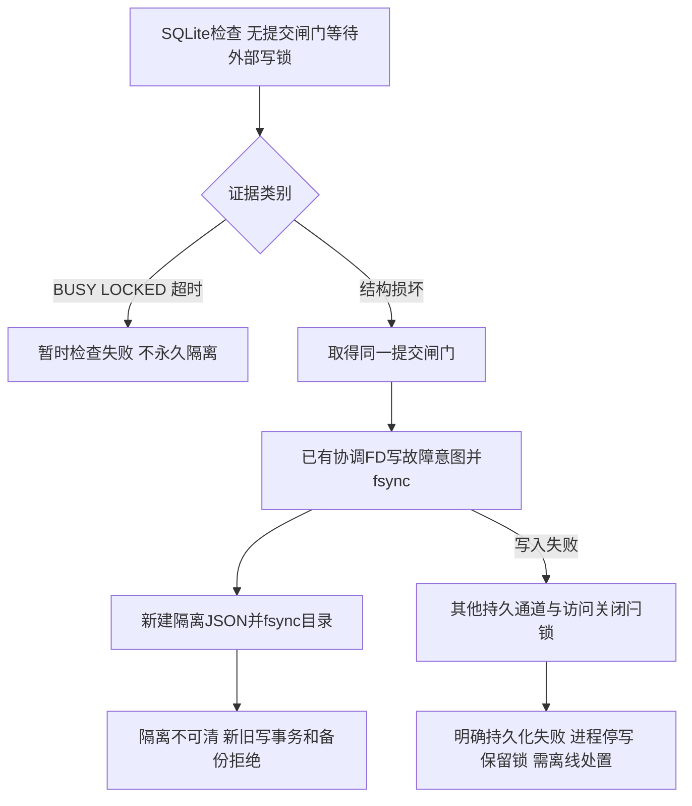
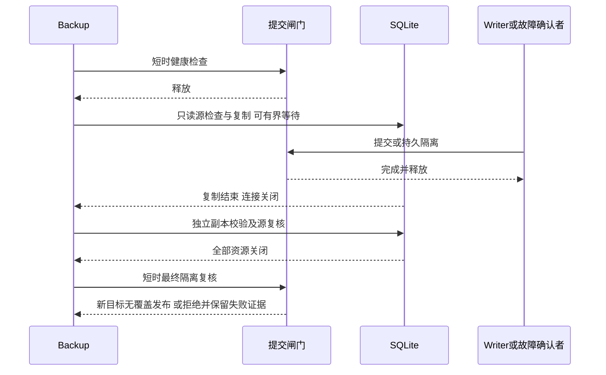

# jianwei P0.3.7-A.3 SQLite完整性保护整改及根因调查报告

本轮仅处理A.2独立复验结论C中的SQLite问题。使用分支`codex/p0-3-7-local-motion-learning`，起始远端证据HEAD为`a52062593bfef21e87fc1a0d2bde42c854ca3c78`，实际A.2代码基线为`642984426e8faa251a776cedee47d48c8529d918`。正式分支`codex/p0-1-foundation`仍为`0bf8fbab9b986940eb8d24a92a7435db06f03ea3`，不合并、不改写。

**结论：已实现并验证生成数据库上的持久隔离、事务/备份保护和取证进程隔离，具备提交独立复验的工程条件；独立原损坏副本及原11次脚本未取得，其复验为blocked。原2/11持久损坏的根因仍为root_cause_not_established，不能宣称已修复损坏产生原因或获得验收通过。** B/C/D未启动，正式科研与P0.4继续blocked。

## 状态与成果入口

| 子任务 | 实现/已测试 | 未验证或受阻 |
|---|---|---|
| A3-01 完整性分类及持久隔离 | 实际完整性结果行、异常类别、不可清隔离、在途提交/跨实例/spawn/重启、持久化失败停写；19项新增 | 极端全部持久介质失效后的断电保持无法保证，须停服务离线处置 |
| A3-02 事务与备份 | 源与副本分离检查、四阶段故障、旧备份保留及未批准恢复阻断；8项新增，旧DELETE/WAL反例保留 | 管理员剥离所有证据后跨位置恢复不属支持接口，需离线核对消费台账 |
| A3-03 损坏调查 | 固定A.2、A.3初次/最终版本各22次，共66次替代工作负载；另2次初始试运行；全部保留 | 未取得独立脚本、原环境日志、损坏页布局；原2/11未复现，根因未确认 |
| 取证工具附加风险 | 同进程关闭普通FD释放SQLite记录锁的真实反例及独立exec修复；1项新增 | 已确认该风险，不证明原事故使用过该工具，也未在该反例中造成结构损坏 |
| A3-04 工程回归 | 本地后端710、前端99、参考29；双构建、桌面/手机协议和双I/O令牌媒体页、离线证据Demo | 独立原件J项blocked；真实现场、断电、跨节点和不可靠网络文件系统不在验收范围 |

- [离线证据Demo ZIP](../demo/p0.3.7-a3/jianwei-p0.3.7-a3-demo.zip)：解压打开index.html；28项新增测试分组、66次全部运行和真实JSON导出。页面不连接API，不含数据库、视频、特征或权重。
- [结构化执行证据及源码SHA](p0.3.7-a3/verification.json) · [全部重复运行](p0.3.7-a3/workload-results.json) · [后端JUnit](p0.3.7-a3/tests/backend-junit.xml)。
- [隔离设计](p0.3.7-a3/A3-01-isolation.md) · [备份边界](p0.3.7-a3/A3-02-backup.md) · [根因调查与取证风险](p0.3.7-a3/A3-03-investigation.md)。
- [媒体页实测桌面截图](p0.3.7-a3/browser/desktop.png)、[手机截图](p0.3.7-a3/browser/mobile.png)；页面入口保留A.1标题，是对当前实现的回归，截图先移除生成视频。离线Demo截图及CI记录见后续证据提交。

## 旧漏洞与源码修复

A.2 `infra/database.py::check_integrity()`对quick_check返回错误行只更新last_integrity_check并抛异常，未调用故障持久化逻辑；依赖异常事件的故障记录看不到这种正常返回的结构错误行。生成freelist头计数损坏副本在固定6429844实际返回完整性失败，但fault为null、隔离JSON不存在，后续受管INSERT成功，独立SQLite连接读取1行。原始生成损坏夹具只供复制，未在原件执行SQLite或业务写入；它不是独立审核的两份原件。

统一实现为[sqlite_health.py](../../infra/sqlite_health.py)，由Database启动/迁移、显式检查、受管连接建立、写事务提交前、备份源/副本检查调用。仓库没有独立的周期检查调度器，本轮不虚构已实现定期服务；运维重复调用统一检查也遵循相同转换。即使关闭迁移的可选启动检查，直接取得受管连接仍须通过结构预检。

检查用SQLite自身VFS及原生私有cursor，不裸开/关闭活跃源DB的普通FD。提交前在已持写锁的同一原生连接检查，不另开等待写锁的连接。代码评审补充了真实反例：应用row_factory/text_factory能将诊断改成ok或使健康检查抛应用异常；已屏蔽私有cursor的行工厂，临时使用原生文本转换并finally恢复应用设置。应用查询仍保留自定义工厂，旧row_factory原生backup目标防线未放开。

| 结果 | 处理 |
|---|---|
| healthy | 返回完整性证据 |
| SQLite CORRUPT/NOTADB（含扩展码），或明确结构错误行 | 取得提交闸门，写持久意图和隔离标记；报DATABASE_INTEGRITY_FAILED |
| 外键违反 | DATABASE_FOREIGN_KEY_FAILED，不冒称永久物理损坏 |
| SQLite报告的CHECK/NULL/非唯一逻辑违反 | DATABASE_LOGICAL_INTEGRITY_FAILED；不把逻辑不一致归为物理损坏 |
| BUSY/LOCKED | 分别报可解释锁失败，允许后续重试，不写物理隔离 |
| deadline/取消/其他失败 | 分别明确超时/取消/检查失败，不无条件写永久fault |

SQLite检查并不替代全部业务约束验证。本地SQLite3.53.1的只读CHECK夹具没有报告CHECK违反，读写检查则报告；最终用SQLite真实报告的NULL违反验证逻辑分类，不把未检出的CHECK写成已验收。

## 持久状态与故障先后顺序



状态绑定规范逻辑路径SHA和当时device/inode。旧版标记可读取，不重写历史fault。受管数据库要求独立普通文件，硬链接别名、不安全协调文件及运行期间inode替换拒绝。新Database/线程/进程会读取独立控制状态；原路径换成旧健康副本也不能清除隔离。

隔离线性化点是提交闸门内故障意图持久化。已有事务若在更早时刻完成提交则保留；如果fault先持久化，在途commit、SQL COMMIT/END/外层RELEASE、属性隐式提交和新会话均阻断/回滚。提交与记录故障共用同一闸门，真实屏障验证两个顺序。ROLLBACK允许在隔离后执行且不需争用提交闸门，以释放SQLite锁。

主JSON写失败时已持FD的意图独立持久化，跨进程可见；两内容通道都失败时尝试fsync访问关闭元数据闩锁，运行期还保留锁和进程级停写记录。任一通道失败明确报DATABASE_ISOLATION_PERSISTENCE_FAILED，不当成正常成功。若连元数据/所有持久介质都无法保存，不宣称断电后有可靠记录；必须停服务、保护原文件并离线处置。普通业务没有清标记、恢复或重新开放已消费test的接口。

## 备份锁顺序与有效性



SQLite锁等待、复制、完整性和SHA阶段均不持全局提交闸门；保留A.2 DELETE/WAL writer-first反例。新增开始前、复制校验后及发布前的源结构检查。before_copy、after_copy、after_validation、before_publish四屏障中确认隔离均拒绝有效发布；即使副本完整也不能忽略源已隔离。仅目标损坏则失败但不误隔离健康源。复制异常在关闭资源后复查源，回执保留原异常类型。

失败保留partial及invalidated/failed/cancelled/timeout回执。有效目标只允许新文件，不覆盖历史库或备份。先published后故障的历史字节和回执不变；带回执的备份不能直接作为可写业务库，需离线核对封存消费台账，禁止通过旧备份自动复用test。同路径外部覆盖不能清除独立fault；管理员跨路径复制并剥离控制证据不属应用支持的恢复路径。

等待有明确deadline/取消/关闭处理；可信phase/progress观察者必须短时，不执行数据库写事务。无界恶意回调、卡死内核I/O、断电与跨节点文件锁未验证，不以加大busy_timeout或线程池掩盖互等。

## 根因调查与所有重复结果

未取得`jianwei_P0.3.7-A.2_独立复验证据.zip`及损坏副本，本轮没有对独立原件做任何写入。J项保留blocked，生成freelist夹具不能冒充原件验证。

每次替代运行在新目录、新进程使用实际API合成导入、迁移、多实例/线程写入与保存点、在线备份、progress异常/取消、EXCLUSIVE写者先占锁、超时、关闭重启、spawn写者和未提交os._exit(17)。检查每个关键阶段及最终工作副本；记录连接ID、PID/线程、事务状态、日志模式、文件身份、单调时序、退出码与源代码SHA。控制器超时终止该运行进程组，不遗留写者，不删失败。

| 版本 | DELETE种子0–10 | WAL种子0–10 | 结构损坏观察数 |
|---|---:|---:|---:|
| 固定A.2 6429844 | 11通过/0失败 | 11通过/0失败 | 0/22 |
| A.3初次版本（提交前实际文件SHA，基于3355044） | 11通过/0失败 | 11通过/0失败 | 0/22 |
| A.3最终核心04b9ee2 | 11通过/0失败 | 11通过/0失败 | 0/22 |

另2次初始试运行通过，单列保留，不混入66次主体统计。所有运行包括取消/超时这类预期结果、最终完整性和退出状态均导出。原始数据库、partial、NPZ、细粒度跟踪留在忽略目录artifacts/p037-a3，不上传GitHub；CI仅上传生成数据的标量结果/文本跟踪。

已确认旧取证helper在同进程关闭普通源DB FD会释放POSIX记录锁，独立exec修复有真实锁竞争证据；子进程不DML，父事务回滚，该反例字节不变且完整性ok。**这是一项真实风险修复，不是原2/11结构损坏根因。** 当前替代工作负载未复现持久损坏，不推断SQLite本身、在线备份、文件系统或写并发是原事故根因。后续需原脚本、损坏页、Python/SQLite/文件系统及崩溃顺序证据，才能缩小最小序列。

## 回归、失败与环境记录

本地Python3.12.14、SQLite3.53.1、Node24、Chromium154.0.8037.57，PyTorch/ONNX可用。最终后端**710通过、0跳过**；新增28项=完整性19+备份8+取证1。前端99/11文件、参考29、生产/Demo双构建通过。结构化JUnit和日志已保存；测试通过不等于独立工程验收或真实学习验收通过。

旧保存点11、原生备份目标/row_factory14、A.2备份18、原媒体/租约及工具配方、正式研究协议44等均在全量中保留。真实浏览器检查协议缺失/登记、会话门槛、合成训练/封存机制、双I/O令牌五媒体状态、播放定位、导出及桌面/手机布局；生成样片不代表工业研究数据。新离线Demo验证28项筛选、全部66次显示、JSON精确导出和零API/远程请求。CI保留原四场景、SOP/原视频回查、216开发静态/8preview和普通文本优化缓存回归。

本轮不重做A.2未完成的原优化缓存媒体/Base64内容专项，其限制继续保留，不宣布封存媒体所有路径已独立复验通过。未尝试绕过用户所述平台内容提示；本轮无可核实的自动审批拒绝，不虚构其原因。

| 中间失败或限制 | 保留证据 | 处置/当前状态 |
|---|---|---|
| 首个索引顺序夹具未被quick_check识别 | tests/baseline.log | 不用它冒充已复现；另保留真实freelist错误行反例 |
| 双内容通道失败初版，预期子进程错误码不匹配 | tests/integrity-new.log：1失败11通过 | 增加访问关闭闩锁及跨进程停写验证，最终通过 |
| 本地Python无enable_shared_cache API、只读CHECK夹具未报错 | tests/integrity-expanded.log：2失败14通过 | 用真实共享缓存URI隔离分类进程及真实NULL违反，未删安全要求；最终通过 |
| 结果工厂遮蔽诊断/执行应用回调 | tests/factory-before.log：3失败 | 私有转换隔离及finally恢复，相关41通过；最终全量通过 |
| 原11次/2份独立损坏副本缺失 | 结构化证据independent_evidence_available=false | J项blocked；根因未确认 |

上述路径均相对[p0.3.7-a3](p0.3.7-a3)。另保留先前707项通过日志，最终710项不是删失败测试取得。2项已知弃用警告为Starlette BlockingPortal别名与旧fork隔离回归的多线程fork提示；正常应用不依赖fork共享连接，新增进程验证使用spawn。

## 提交与独立复验

| 提交 | 内容 |
|---|---|
| e7b2889 | 完整性统一分类、持久隔离、身份与提交保护及16项初始测试 |
| 3355044 | 源备份边界、恢复审查阻断和8项新增 |
| 841a098 | 取证独立进程、真实锁回归和全量可追踪重复脚本 |
| 04b9ee2 | 结果工厂不能遮蔽私有健康诊断，3项真实反例 |
| 后续证据提交 | 完整报告、真实结果Demo及CI记录，见Git历史及CI.md |

代码与证据提交分开记录，不把文档HEAD冒充实际执行代码；`verification.json`逐文件SHA对应最终核心。实际交付代码[fb69646336eb6346ea3cec498a08856a80a34e60](https://github.com/qoxgain/jianwei/commit/fb69646336eb6346ea3cec498a08856a80a34e60)的[CI41804872121](https://github.com/qoxgain/jianwei/actions/runs/41804872121)三个作业全部通过：基础707通过/3项缺torch跳过，独立编码器9通过/0跳过，前端99、参考29、双构建及全部浏览器检查通过。CI Python3.12.15/SQLite3.45.1另外4次生成工作负载通过，和本地66次分开保留；根因仍未确认。[CI记录与实际JUnit](p0.3.7-a3/CI.md)详细列出跳过，不将它写为通过。

复验只用新生成目录与隔离数据库，不接现场，不消费正式封存数据：

```bash
.venv/bin/python -m pytest tests/test_p037_a3_*.py tests/test_p037_a2_backup.py tests/test_p037_a1_backup.py tests/test_p037_a1_savepoints.py tests/test_p037_transaction_gate.py tests/test_sqlite_reliability.py tests/test_research_protocol.py -q
.venv/bin/python -m scripts.check_sqlite_forensic_lock --output artifacts/a3-independent-forensics
.venv/bin/python -m scripts.investigate_sqlite_workload --output artifacts/a3-independent-workload
.venv/bin/python tests/browser_p037_a3_offline.py --output artifacts/a3-independent-offline
.venv/bin/python -m scripts.package_p037_a3_demo --verify-only
```

取得独立损坏库后，先停止其所有写者，使用`python -m scripts.inspect_sqlite_copy --database /path/to/original --output-dir /path/to/NEW-evidence`保存原件哈希/DB/WAL/SHM/journal；该命令仅在独立进程裸读原件，SQLite检查新working副本。再把工作副本复制到另一个新临时目录，用受管Database.check_integrity复验隔离/提交/备份，并核对原件哈希。不要把原件路径交给迁移或业务写入；不要向GitHub上传原损坏库。

## A–E自评与准入

| 条件 | 当前自评 |
|---|---|
| A 封存媒体不可经API/Vite/产物访问 | 已执行媒体/静态保护回归；A.2原缓存媒体/Base64专项限制仍在，不能宣布完整独立验收通过 |
| B 故障后受支持受管提交不能成功 | 结构损坏持久隔离、在途/跨连接/spawn/重启及保存点路径生成数据测试通过；独立原副本J项待执行 |
| C 媒体锁等待/取消释放正确 | 双I/O令牌与任务租约回归通过，无新增线程池互等 |
| D 工具变化/异常使身份失效 | 未改变工具与v1–v5配方，已有真实探测/版本测试保留通过 |
| E 既有功能与正式研究保护无新增阻断 | 已执行全量及浏览器通过，不改历史正式分支、不覆盖历史数据；根因、现场、断电/跨节点仍未验证 |

支持范围是单机Linux、可靠本地SQLite文件锁、所有应用写者使用同版A.3受管API、控制状态不被管理员外部删除。任意非受管/旧版写者、手工修改数据库/控制文件、多节点网络文件系统和剥离消费台账恢复不在保证范围。每次写提交做完整结构检查有性能成本，大库延迟/吞吐须在后续隔离压测中量化；不以性能理由降低本轮隔离标准。

**交付后停在A.3，等待独立审核。原C结论须由独立复验重新判定，不根据本地/CI全绿自动开放B阶段或正式P0.4。**
