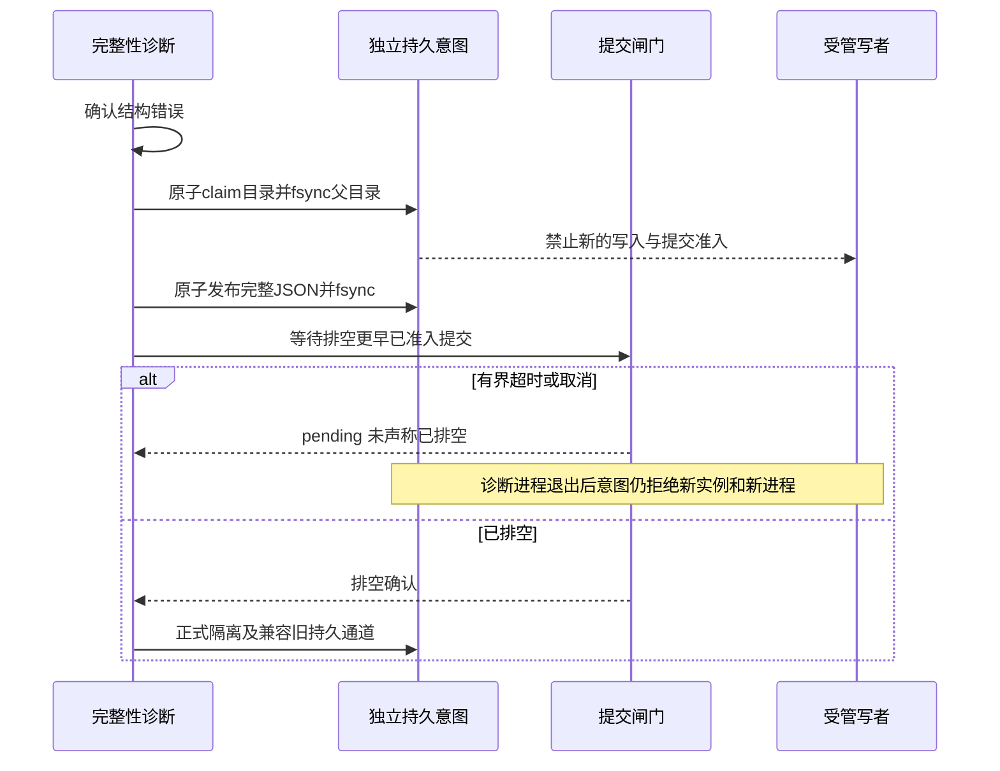

# P0.3.7-A.4 数据库故障隔离闭环与性能优化报告

本轮仅整改A.3独立结论C指出的闸门超时持久化缺口、失效备份业务准入及事务性能问题。开发分支保持`codex/p0-3-7-local-motion-learning`；固定代码基线`fb69646336eb6346ea3cec498a08856a80a34e60`，起始证据HEAD `052fe9588f78ea070b6b9a568e115588722735ff`。正式分支`codex/p0-1-foundation`不修改、不合并，历史A.3代码、报告和Demo保留。

**本轮交付工程修复与生成数据验证，不宣称独立验收通过。原历史损坏产生根因仍为root_cause_not_established；未取得两份历史损坏库或独立证据ZIP，其本机精确复验仍blocked。轻量策略的检测保证变化须独立确认，根配置默认仍full。B/C/D和正式P0.4未启动。** 用户提供的独立事实“两份历史副本正常路径可以隔离”作为审核输入引用，没有冒称本机重复执行过。

## 查看交付

- [离线证据Demo ZIP](../demo/p0.3.7-a4/jianwei-p0.3.7-a4-demo.zip)：解压后在目录运行`python -m http.server 18064 --bind 127.0.0.1`，打开`http://127.0.0.1:18064/index.html`；按容量、日志模式、写者、备份和隔离状态查看真实TPS/延迟/资源、全部失败及新增测试，下载JSON。
- [结构化结果与源码SHA](p0.3.7-a4/verification.json) · [最终性能全部案例](p0.3.7-a4/performance-results.json) · [初版全部案例](p0.3.7-a4/performance-initial-results.json) · [CSV](p0.3.7-a4/performance.csv)。
- [性能解释与全部对照](p0.3.7-a4/PERFORMANCE.md) · [初版性能与失败](p0.3.7-a4/PERFORMANCE-INITIAL.md) · [失败后的独立只读检查](p0.3.7-a4/performance-failure-checks.json)。
- [持久意图协议](p0.3.7-a4/A4-01.md) · [备份准入设计](p0.3.7-a4/A4-02.md) · [检测策略及架构决策](p0.3.7-a4/A4-03-strategy.md)。
- [后端JUnit](p0.3.7-a4/tests/backend-junit.xml) · [实际浏览器与截图](p0.3.7-a4/browser) · [CI记录](p0.3.7-a4/CI.md)。

Demo没有数据库、视频、特征或权重，不连接API；仅呈现实际执行结果。大整数时间戳以十进制字符串保留，避免浏览器精度损失；原标量指标不造数。

## 完成状态与剩余事项

| 工作 | 实现及测试 | 未验证/待确认 |
|---|---|---|
| A4-01 闸门超时隔离 | 闸门外持久意图、pending/正式排空边界、在途/跨实例/spawn/重启拒绝；11项新增 | 已进入native COMMIT者可能在意图产生后完成；不能把意图当作排空确认 |
| A4-02 生命周期准入 | 内部身份、路径/inode登记、生命周期、改名/复制/中断、legacy审核与RecoveryPending；22项新增 | 没有恢复批准执行接口；未知旧文件须人工确认来源，不能自动认定业务库 |
| A4-03 性能 | 显式fault_state、完整巡检、关键研究/备份边界、监控计数和有界等待；17项新增；两版各144实际性能案例 | 默认full未改；轻量策略扩大未发现损坏窗口，须独立认可后显式选用，不是等价安全证明 |
| A4-04 兼容回归 | 全量后端、前端、参考、双构建及桌面/手机回归记录见下方 | 历史实际副本、断电、跨节点、不可靠文件系统和现场SLO未验证 |

## 固定A.3反例与原因

[baseline.json](p0.3.7-a4/baseline.json)由固定fb69646工作树和生成freelist计数错误副本实际执行：另一个spawn进程占有commit_gate；诊断确认为结构错误，100ms后报DATABASE_ISOLATION_PERSISTENCE_FAILED；主标记未创建，诊断进程退出后新实例fault=null。原因是`Database._isolation_boundary()`在等待失败分支仅填当前进程变量，旧持久通道都位于该闸门之后。

本生成夹具的新连接完整检查能重新发现损坏，实际记录为DATABASE_INTEGRITY_FAILED；**没有将它冒称为历史损坏库仍可提交的完整反例**。本轮以持久状态必须跨诊断退出保留为核心修复，历史精确写绕过路径待原件复验。

第二反例实际完成：备份最后一页回调触发生成故障，回执invalidated且目标未发布；但partial仍可通过Database.migrate/受管INSERT新增1行，改名后再新增成为2行。A.3仅检查相邻目标名的`.backup-*.json`，不覆盖暂存inode和随文件转移的身份。原始生成失败副本另存保留，未修改实际历史数据库。

## 独立持久意图与提交顺序



三时点不同：证据确认、停止准入意图持久化、提交闸门排空后的正式隔离确认。目录原子出现即fail closed，元数据未写完或进程中断也不会恢复健康；JSON用新临时文件fsync和无覆盖链接发布。控制状态绑定规范路径及当时device/inode，不自动清除。无需先取得繁忙commit_gate，且不裸开/关闭源SQLite普通文件FD。

未获得提交准入的既有事务在闸门处拒绝并回滚；新SQL准备也经authorizer核查。已在native COMMIT中取得准入者不能被另一进程安全撤销，可能在意图之后完成；它属于意图之前准入的操作，正式isolated确认须等其释放闸门。真实屏障测试保留这一合法先后顺序，不用测试成功宣称没有竞争窗口。

独立通道失败时还有主停止标记、已有协调通道及访问关闭元数据闩锁；明确报错并停写。所有内容/元数据/持久介质都不可用时，不能靠内存承诺重启保护，必须停止所有应用写者并离线处理。强杀发生在任何持久意图发布前时也不能凭丢失内存恢复检测结论，启动/连接完整检查属于检测层。普通BUSY/LOCKED或超时未确认结构损坏，不创建永久物理fault。

新机制不在持提交闸门时开启另一个可能等待SQLite写锁的连接。ROLLBACK仍不需争用该闸门，备份复制/读取在外，原A.2 DELETE/WAL反例保留；不增加AnyIO线程池或busy_timeout掩盖互等。

## 业务与备份生命周期

内部受保护表`_jianwei_database_identity`保存版本、UUID、Active/Backup及业务规范路径绑定；独立登记绑定device/inode/UUID/路径。可选xattr标记尚未完成的生命周期，回执保存精确操作历史；缺xattr时不丢失内部身份或未知文件默认拒绝。普通业务SQL不得改写内部身份。

| 状态/来源 | 业务写入准入 | 已执行验证 |
|---|---|---|
| 新路径初始化Active | 允许，注册后可迁移/Session/重启 | 新业务创建、持久记录与再打开 |
| 正常旧业务无身份 | 未审核拒绝；停写、具名、SHA及消费台账复核后登记 | 旧行/ID保留，后续迁移与新增成功；错SHA拒绝 |
| Copying | 拒绝 | 复制暂停及进程异常退出后重启；空文件复制不视为新库 |
| Validating | 非Active，拒绝 | 完成复制后内部Backup标记、既有校验边界与发布保护 |
| Invalidated | 拒绝 | 直接路径、改名、去xattr复制均未新增行 |
| Failed/Cancelled | 拒绝 | 回调异常/取消、重命名和复制均拒绝 |
| Published | 原生只读完整核验允许，业务写入拒绝 | 不因无敏感后缀或legacy审核调用而放行 |
| RecoveryPending | 不批准写入 | 具名请求留痕，归档字节和已有回执不变 |
| 登记丢失/身份变化/已隔离 | 拒绝，不自动重建或清fault | 逻辑原路径覆盖后仍受隔离，登记不匹配不恢复业务 |

完整复制后，在独立副本中写Backup身份，再校验/哈希/发布；源业务身份不变。此备份不是逐字节取证原件的替代品，原始取证仍用A.3独立进程工具并仅检查新工作副本。复制中若还带源Active元数据，目的路径绑定不同而拒绝；若身份页尚未复制，未知旧文件必须审核，不自动获得新库资格。

纯无标记字节无法可靠分辨旧业务库与旧备份，故兼容是明确审核迁移，不承诺零操作自动升级。审核工具不接纳任何已识别备份，也不清隔离/批准恢复；现有正常业务表、ID和数据保留，追加身份元数据有SHA和审核引用。既有A.3服务需先停写升级，不能混用会忽略新意图的旧版写者。

## 完整性检测策略与性能

默认`sqlite.commit_integrity_check: full`保留A.3每次写提交扫描，不能据可选策略的成绩宣称默认TPS已经根本改善。显式`fault_state`只在提交路径执行持久意图/fault、数据库/登记身份与事务约束，仍保留提交闸门、FULL同步、原生backup能力边界和即时SQLite错误处理。新字段缺省时不漂移历史配置快照哈希。

所有策略都在连接建立、旧库审核、备份源/副本和正式研究排队/保留test、执行读取特征、消费封存标记前完整检查。后台完整巡检需显式配置`integrity_check_interval_seconds`，不把quick_check当完整校验。健康接口报告策略、实际尝试/完成数及最近失败，不提供虚构的发现SLA。

初版零等待巡检在真实持续写入矩阵出现发起却完成0次的案例，不能只报告线程已启动。现改为统一配置的有界SQLite锁等待，仍在commit_gate之外；真实EXCLUSIVE短写释放屏障验证首轮能够完成。初版144案例（142通过、2个A.3完整检查超时）全部保留，另起目录重测最终144，不覆盖失败。

最终144/144案例通过，16个隔离案例成功提交均为0；48/48健康轻量案例在测量窗口至少实际完成一次完整巡检。约79MiB、DELETE单写者且无在线备份，两轮A.3为15.07–16.55 TPS，A.4轻量+巡检为660.64–728.74 TPS，中位TPS比约43.9倍；默认full为16.01–16.60 TPS，没有把可选成绩冒充默认收益。完整结果覆盖所有容量/并发/备份组合，不只选这一个例子。

最终量化结果见[PERFORMANCE.md](p0.3.7-a4/PERFORMANCE.md)。使用同一生成布局、容量、同步、缓存、客户端、语句和锁/检查预算，版本顺序按种子打乱；固定A.3为主对照、A.2为79MiB辅助对照，A.4 full测加固成本，轻量主实验开启1秒完整巡检。单列启动/完整检查、实际TPS及p50/p95/p99、CPU/RSS/I/O、锁失败率、备份重叠时间；隔离16案例成功提交应为0。

即使完成率改善，轻量策略仍可能在损坏尚未发现时继续提交。发现依赖下一次成功完整检查或SQLite异常；持续锁竞争、检查超时、系统调度和全部存储故障均可扩大窗口，周期配置不构成严格延迟保证。性能结果属于生成数据工程测量，短跑p99/少量基线样本不是现场SLO。后续可评估批量事务、异步有界队列或分拆存储职责，本轮不迁移数据库或改变事务口径制造收益。

## 回归、失败与版本

本地最终Python3.12.14/SQLite3.53.1：**后端760通过、0跳过，2项已知弃用警告**（Starlette别名与旧fork隔离测试）；前端99、参考29及生产/Demo双构建通过。新增50项无跳过；故障/备份/保存点/row_factory/取证文件锁/正式科研协议保留。另4次生成API、导入、并发、备份与异常退出端到端运行完整性均ok。

新增50项：持久意图11、备份准入22、检测/性能策略17。前端99、参考29、TypeScript及生产/Demo构建执行记录见tests。真实浏览器包括研究协议、会话门槛、合成研究机制、双I/O令牌五媒体状态与播放导出、桌面/手机布局，以及新增离线证据过滤、失败显示和精确导出。CI保留原四场景、SOP/开发样片、静态216/preview8及普通文本优化缓存回归。

本轮不重跑A.2原缓存媒体/Base64精确用例，其未验证限制不自动解除。没有尝试绕过平台内容提示；实际历史损坏库未修改或上传。工程CI成功不等于独立审核通过。

附加file://直接打开尝试返回net::ERR_BLOCKED_BY_ADMINISTRATOR，属于本云浏览器管理员策略；未修改、禁用或绕过策略，也不虚构成工具自动审批拒绝。Demo已通过正常回环HTTP桌面/手机验收，包内给出这一已验证方式；不声称本环境file://已通过。

| 保留的失败 | 处置 |
|---|---|
| 首轮准入相关18失败 | 原生成旧业务夹具未登记；增加明确离线审核步骤，未移除原隔离断言 |
| DELETE并发身份读取1失败 | 零等待身份读被正常竞争打断；在提交闸门外使用配置的有界等待，随后124项相关回归通过 |
| 首轮全量1失败/758通过 | 精确迁移表清单缺新增受保护身份表；保留集合断言并加入该表，随后759项通过 |
| 初版性能2失败 | 固定A.3完整检查超时；状态保留。只读取证副本完整性ok、独立行数12/18与报告提交数相符，不是结构损坏证据 |
| 初版巡检未完成 | 不伪称巡检成功；有界等待修复并单独提交，70项策略/协议/可靠性回归通过，最终另测全部144案例 |
| 两份历史原件/证据ZIP未取得 | 精确原件复验blocked；接受用户独立审核事实作为引用，不冒称本机执行 |

原始生成数据库、partial、WAL、采样延迟和跟踪留在忽略的artifacts/p037-a4；公开仅源代码、测试、脱敏标量CSV/JSON、截图及不含数据库的Demo。公开文本日志仅规范化ANSI/行尾空白，保留原SHA；没有丢弃失败记录。

| 提交 | 内容 |
|---|---|
| 0cb3b87 | 先持久化停止准入意图，再等提交闸门；11项跨进程等回归 |
| 898afba | 内部业务身份/备份生命周期、legacy审核及准入回归 |
| 5c1eb58 | 显式轻量提交、完整巡检与正式研究边界、实际性能测量脚本 |
| af7a6ec | 修复零等待巡检饥饿并增加真实EXCLUSIVE屏障 |
| 55c0ac5 | 配置schema发布清单与精确迁移表回归 |
| 后续交付/证据提交 | 最终测试、性能、Demo与CI，见Git历史及CI.md |

性能初版执行核心5c1eb58，最终核心55c0ac5；每例另存代码SHA、版本、完整配置、种子和输入SHA，不把后续文档HEAD当作实际执行代码。CI结果及缺依赖跳过将单独记录，不计为通过。

## 独立复验与部署范围

```bash
.venv/bin/python -m pytest tests/test_p037_a4_*.py tests/test_p037_a3_*.py tests/test_p037_a2_backup.py tests/test_p037_a1_savepoints.py tests/test_p037_a1_backup.py tests/test_sqlite_reliability.py tests/test_research_protocol.py -q
.venv/bin/python -m scripts.benchmark_sqlite_a4 --smoke --output artifacts/a4-independent-smoke
.venv/bin/python tests/browser_p037_a4_offline.py --output artifacts/a4-independent-offline
.venv/bin/python -m scripts.package_p037_a4_demo --verify-only
```

完整性能需新worktree固定fb69646和6429844，避免LFS下载：

```bash
GIT_LFS_SKIP_SMUDGE=1 git worktree add --detach /tmp/jianwei-a4-review-a3 fb69646336eb6346ea3cec498a08856a80a34e60
GIT_LFS_SKIP_SMUDGE=1 git worktree add --detach /tmp/jianwei-a4-review-a2 642984426e8faa251a776cedee47d48c8529d918
.venv/bin/python -m scripts.benchmark_sqlite_a4 --output artifacts/a4-independent-performance --a3-root /tmp/jianwei-a4-review-a3 --a2-root /tmp/jianwei-a4-review-a2
```

只支持可靠本地文件系统、单机Linux文件锁、同版A.4受管写者与未被外部删除的控制记录。内存库仅进程内演示，不能宣称跨重启持久隔离。外部管理员裸写/删除元数据、多节点网络文件系统、强杀发生在持久化前及卡死内核I/O不在严格保证内。所有持久通道不可用时须停全部服务；没有清fault或自动恢复接口。

拿到真实损坏副本后，先核对SHA并停止原件写者，独立进程取证到新目录，再复制working副本到另一个新测试目录复验；不得给原件运行迁移、legacy登记或恢复，不上传原损坏库。将闸门占有/超时、诊断退出、重启及各写入路径重新施加到两份副本；未做前不把生成夹具代替其全部验收。

本轮具备把代码、生成证据和已知边界交独立审核的条件；原件复验和轻量策略保证变化仍须确认。**交付后停在A.4，不根据TPS或CI自动开放B/C/D与正式P0.4。**
