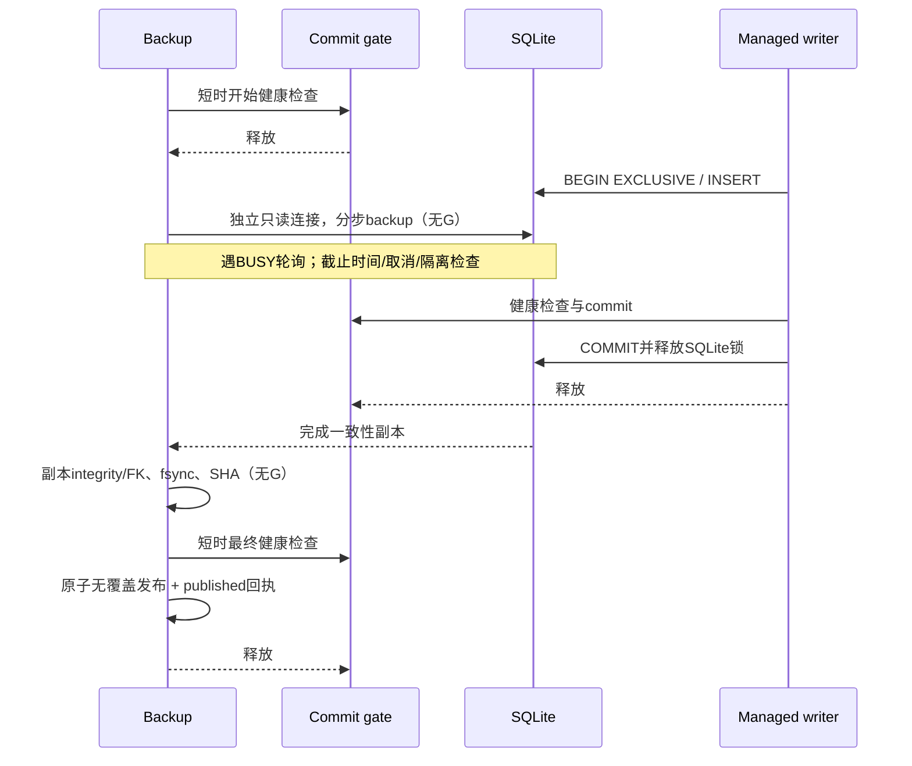

# A.2 R02 在线备份锁顺序与发布

仅使用生成数据库。固定5f150e7的真实线程/EXCLUSIVE反例：DELETE中native backup已经开始，busy_timeout=200ms，备份和commit在1秒后均未完成；WAL对照能完成且独立连接读到提交行。复现源码：scripts/reproduce_p037_a2_backup_baseline.py；完整结果在A.2交付汇总中保存。未取得独立审核DOCX/ZIP，按用户完整复现条件执行。

旧顺序为备份取commit_gate → 等SQLite写者；写者持EXCLUSIVE → 等commit_gate，形成环。新顺序如下：

文件源使用私有、只读SQLite连接，避免engine新连接PRAGMA在EXCLUSIVE下也带入提交闸门。内存库仅单连接、无并发写入时保留私有源能力。源连接绝不作为受支持备份目标公开，六种未经批准目标和row_factory防线保留。backup不再等待SQLite锁时持有全局闸门，故障标记可以在复制时及时持久化；进度检查和最终闸门检查共同阻止故障后的有效发布。

唯一新副本先写独占partial文件；执行完整性和外键检查、文件fsync与SHA，再在最终闸门内以link原子创建新目标并写published回执。并发同名发布只能有一个成功，现有目标/备份及符号链接不被覆盖。失败副本与独立operation回执保留，标为failed/timeout/cancelled/invalidated，不以目标路径发布；不自动恢复、清故障或改消费记录。已完成发布之后才发生故障，历史published回执保留，仍不得据此解除原库隔离。

可选统一配置sqlite.backup：timeout_seconds默认10、pages_per_step=64、retry_seconds=.01。旧配置未显式提供backup时，配置快照不增加默认字段。等待提交边界也以短片轮询，检查取消与截止时间。Database.close取消本实例在途备份；progress为可信、短时观察回调，不得执行数据库事务或无界阻塞。截止保证以正常本地文件系统及可响应SQLite为前提，不是对卡死内核I/O或恶意回调的硬实时证明。

原始database disk image is malformed根因仍未确认。正式源库/工业研究记录未用于本轮复现，封存消费状态、故障标记和历史备份不被重写。

本子任务18项新增真实SQLite测试；连同六种目标/回调、故障提交、并发可靠性、配置与旧迁移共65项通过。前端99项并行测试、生产与Demo构建通过。最终完整回归和CI见A.2总报告。
