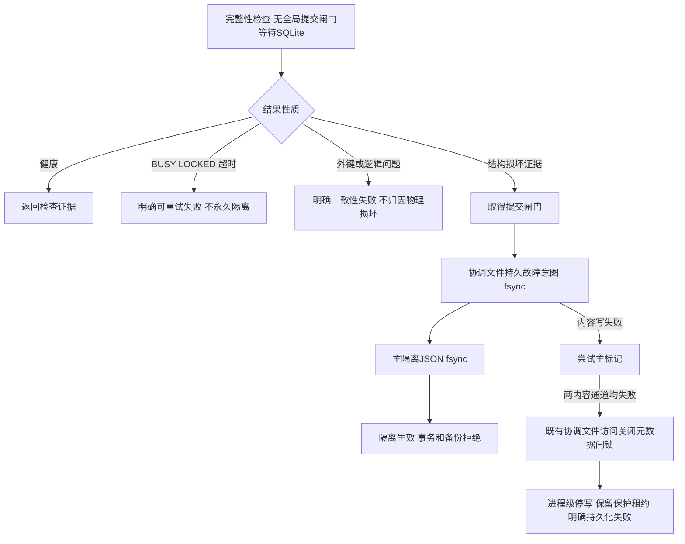

# A3-01 完整性结果与持久隔离

固定A.2代码6429844，生成freelist计数错误副本实际返回结构错误行，但check_integrity只抛DATABASE_INTEGRITY_FAILED，没有写隔离标记，后续事务提交1行。工作原始夹具和首次未触发quick_check的索引夹具记录均保留，不是独立审核提供的原2/11损坏库。

统一检查改用SQLite自身VFS的完整integrity_check；不裸开/关闭活跃数据库文件做哈希。结果区分healthy、structural_corruption、foreign_keys、logical_consistency、busy、locked、timeout、cancelled、check_error。外键与逻辑问题报错阻止检查/迁移继续，但不冒称永久物理损坏；BUSY/LOCKED/超时不写物理隔离标记。SQLite实际逻辑检查覆盖不等于业务约束完整验证。

结构证据在闸门外取得；已进入提交闸门的事务可以先完成。闸门内持久故障意图是隔离线性化点，检查失败返回前完成标记或明确报DATABASE_ISOLATION_PERSISTENCE_FAILED并停写。在途和新事务先查隔离，再进同一闸门复核。写事务提交前也在自己的原生连接中复核结构，此时已经持有SQLite写锁，不新开SQLite连接等待其他写者。新原生连接不可绕过预检；连接本地PRAGMA不在全局闸门下等待。ROLLBACK不需争用提交闸门，以释放在途SQLite锁。

隔离v3记录绑定规范数据库路径的SHA、设备和inode；原路径更换文件或旧备份覆盖不会清除独立控制状态。文件必须是独立普通文件，硬链接别名及不安全协调文件拒绝。旧版隔离JSON继续接受且不重写；普通API不能清除。

主JSON创建失败时，已有协调FD中的持久意图可跨进程/重启观察；两内容通道均失败时尝试持久关闭协调文件访问，运行期另保留安全锁和进程级停写记录。任意通道失败均明确报错，不将降级记录为正常成功。若连访问元数据与所有持久介质均不能保存，不能声称断电后状态可证明，必须停服务、保留锁并离线处置；无自动恢复路径。单机可靠本地控制存储是支持前提。

16项新增真实SQLite测试通过；连同事务、保存点、A.2备份与可靠性相关回归67项通过。覆盖损坏结果行、源字节不改、在途提交阻断、spawn/重启/旧副本覆盖、主标记失败、内容双通道失败、实际BUSY/LOCKED、逻辑NULL/FK、健康迁移备份及提交先完成顺序。独立审核原损坏副本尚未取得，不能宣称完成其复验。完整回归和CI将在总报告记录。

提交前追加3项真实反例：应用row_factory/text_factory能将结构诊断改成ok，或对健康结果触发应用异常。私有检查现禁用cursor行工厂并临时使用str转换，finally恢复应用设置；这些回调不进入提交健康边界。三项修复前失败、修复后通过，最终完整性专项19项，全量后端710项；原16项阶段结果保持上述历史记录。
