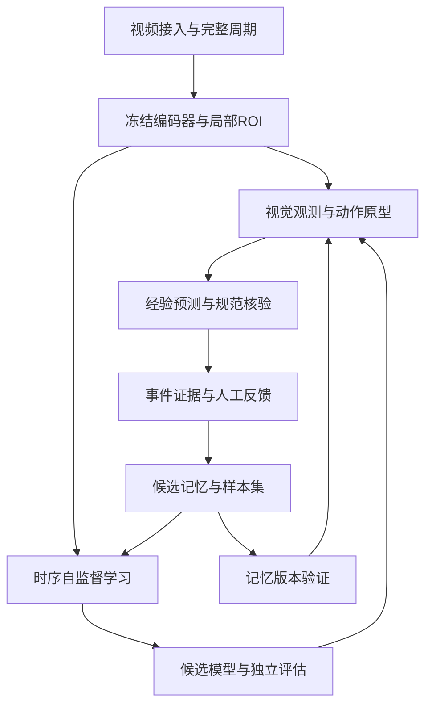

# 04 系统架构与数据存储

## 服务边界

媒体播放、采集、特征推理、时序状态、教师复核、训练调度、API进程隔离。长任务只返回job_id；API不能同步等待模型推理或特征入库。复用既有系统时，通过适配器接入原视频特征和Milvus，保留原业务ID映射，不直接修改现有生产数据库。

| 模块 | 输入输出 | 失败行为 |
|---|---|---|
| MediaAdapter | RTSP/文件到PTS帧、WebRTC/HLS播放 | 重连、标记时间缺口 |
| EncoderAdapter | 历史clip到特征和特征空间ID | UNAVAILABLE，禁止用随机向量代替 |
| Segmenter | 特征流到动作候选区间 | 保留unknown，边界可后验修订 |
| MemoryRetriever | 特征与上下文到候选、反例、距离 | 无匹配则unknown |
| Forecaster | 历史到未来分布、时间范围 | 退回固定基线并标明版本 |
| TeacherAdapter | 证据与标签定义到候选JSON | 超时排队不阻塞采集 |
| Verifier | 证据、质量、反馈到标签质量层级 | 冲突隔离 |
| MemoryBuilder | 合格样本到candidate快照 | 失败保留active |
| TrainAdapter | 数据快照到模型和训练记录 | 前置不满足返回skipped及reason |
| Evaluator/Registry | 候选与champion到报告/发布状态 | 样本不足返回INSUFFICIENT_EVIDENCE |

P0参考工具使用NumPy、SQLite、YAML；正式实现使用FastAPI、SQLAlchemy/Alembic、关系库、任务队列、对象存储和前端React。生产可在PostgreSQL或已有MySQL中选择一种，选择写入配置并完成方言测试。向量存储选择与关系库独立，不同时引入多种仅作展示。

## 时间与特征协议

所有事件含UTC时间和源视频PTS；同步按PTS而非接口返回时间。多摄像头关联需要时钟偏差测量及对齐容忍值。FeatureBatch含 `tenant_id,scene_id,camera_id,episode_id,entity_id,style_family,source_video_id,source_hash,feature_space_id,encoder_sha,preprocess_sha,pts_start_ms,pts_end_ms,quality,vector_uri`。

长视频编码只输出低频特征，原视频用分段对象存储与索引，避免逐帧BLOB进入关系库。ROI从原始分辨率帧提取，记录原图坐标、变换、帧ID和track_id。特征空间不兼容时拒绝相似度计算；名称相同或维度相同不证明兼容。

## 关键表与唯一约束

| 表 | 核心字段与约束 |
|---|---|
| episodes | tenant、camera、style、sop_version、status、parent_rework_id；完整周期独立ID |
| camera_leases | tenant+camera唯一；owner_session、expires_at、fencing_token |
| evidence | source_hash、video范围、原图ROI、质量、留存期；内容hash去重 |
| feature_batches | evidence_id、feature_space_id、vector_uri、时间窗；唯一evidence+space+window |
| observations | action候选、已核验动作、quality_tier、evidence_ref、版本；保留修订链 |
| predictions | issued_at、input截止、未来窗、概率、predictor_version；不可覆盖 |
| prediction_outcomes | prediction_id、独立观测ID、评分、是否有效；唯一prediction+outcome_version |
| label_revisions | sample、action、actor、source、supersedes、reason；追加不可覆盖 |
| memory_snapshots | parent、scope、space、knowledge、sample_manifest_hash、state、created_at |
| prototypes | snapshot+action+cluster、vector_ref、sample_ids、diversity、quality |
| empirical_transitions | snapshot+context+from+to唯一；count、weighted_count、sample_refs |
| dataset_snapshots | manifest、hash、split_policy、label_version、excluded_groups |
| training_jobs | adapter、dataset、config_hash、status、resource_budget、artifacts |
| model_versions | family、parent、weights_hash、feature_space、compatible_knowledge |
| eval_runs | candidate、champion、dataset_hash、protocol_hash、metric_artifacts |
| releases | 版本元组、state、canary_assignment、gate_report、rollback_to |
| audit_outbox | 幂等事件ID、actor、动作、对象、before/after_hash、投递状态 |

参考SQL `contracts/reference.sql`给出最小记忆与预测表；完整业务表通过Alembic实现。所有scope隔离由服务端校验，客户端tenant字段不能决定权限。

## 版本元组与一致性

一次发布绑定 `config_hash + knowledge_hash + feature_space_id + memory_version + predictor_version + student_version + evaluation_protocol_version`。会话开始锁定元组；模型灰度按完整episode分配，不在半件衣物中切换。回滚必须同时恢复相容的模型、原型和知识引用，不能只替换权重文件。

写入观测、修正和训练触发使用业务幂等键；至少一次投递场景下通过唯一索引去重。训练使用单工位/模型族分布式锁和冷却期，任务重试不重复生成可发布版本。导入、标签核验、模型加载先写临时目录，hash校验后原子提交。

## 数据采集与部署

统一数据目录由配置生成：inbox、clips、features、datasets、memory、models、reports、logs。原视频留存默认15天，证据30天，特征90天，审计180天，均为可调整初值；删除时保留可证明来源的hash与不可重现标记，不能删除评测原件后仍声称可复现。

CPU仅承担编排、检索及轻量头训练；视频编码和教师按实际硬件批处理，可在客户GPU或经允许的独立服务运行。把训练预算与在线推理解耦，达到显存、队列、时延阈值时训练暂停。没有GPU也应能读取预先导出的特征完成学习研究。

所有密码只从env://引用解析，运行配置导出脱敏；原始RTSP地址不下发浏览器。采集URL、证据路径与上传视频均通过已注册资源ID和服务端白名单访问。
