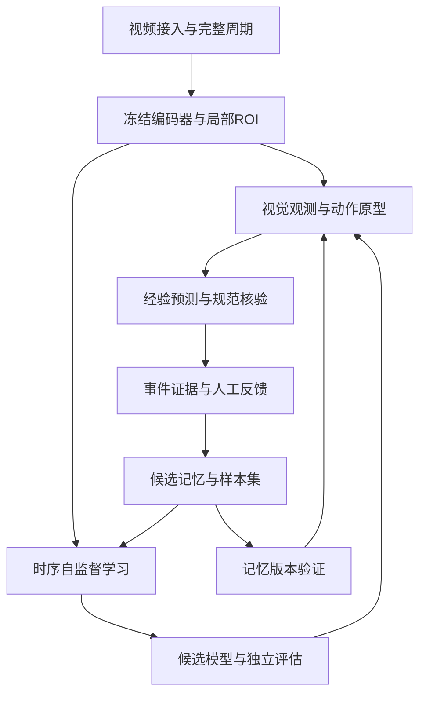

# 见微 V3.0 完整研发与产品手册

2026年10月15日

本版将无标注视频的自监督时序学习、可编辑动作知识、可更新外部记忆和小模型自动训练前移到第一阶段。视觉与全模态大模型权重冻结。研发顺序为先验证学习收益，再扩展完整业务和多场景部署。

本手册是研发实施规格。交接包附有CPU机制验证工具；真实视频推理、模型训练服务和完整产品仍按任务书实现。所有默认阈值均为研发初值，不作为已有性能承诺。

## 文档导航

- 01 产品目标与能力范围
- 02 自学习引擎技术设计
- 03 可编辑标签与外部记忆
- 04 系统架构与数据存储
- 05 评测和自动发布协议
- 06 页面规划与用户流程
- 07 Codex实施任务书
- 08 配置和部署调试
- 09 接口与事件契约
- 10 技术依据和版本变化
- 11 本包验证与交付状态
- 12 局部细节增强与自学习联动

# 01 产品目标与能力范围

## 核心产品决策

名称沿用“见微”，正式描述为“见微多模态自学习感知平台”。首发以固定工位、单件服装质检SOP为试验场景，产品核心是减少动作适配所需的人工标注，同时保留证据、版本比较与回退能力。

用户提供普通生产录像、动作名称与标准SOP；系统自动做采样、特征提取、候选动作分段、聚类、下一状态预测及学习样本整理。固定的视觉语言教师提供候选语义，少量人工确认把匿名动作簇连接到业务动作。持续运行时，经过核验的观测改进动作原型、节拍分布、经验转移概率和小模型。

“无标注视频能自动学习”主要指特征关系、时序规律和动作簇可以自监督学习。仅凭录像不能可靠知道企业对动作的命名、作业是否符合规范，也不能证明准确率提升；语义锚点与独立人工评测仍然需要，但不要求逐帧标注全部训练视频。

## 学习对象与自动化程度

| 对象 | 学习方式 | 默认行为 |
|---|---|---|
| 原始视频时序关系 | 冻结编码器，训练独立预测头或小型TCN/GRU | 自动构建过去到未来的训练对，周期训练 |
| 未命名动作簇 | 时间边界检测、聚类、短片对齐 | 自动发现，保持匿名ID，不自动赋予正式业务语义 |
| 已知动作视觉原型 | 高质量正例、多原型、负例、去重与均衡 | 自动积累候选，符合已知类门槛后激活 |
| 下一动作及时间分布 | 经验转移模型与轻量时序网络 | 自动校正，分别保存经验预测与SOP允许动作 |
| 已知动作语义标签 | 固定Qwen候选解释加独立视觉证据 | 置信校准和抽检通过后进入弱标签池 |
| 新类别、规范SOP | 人工标签文件或页面编辑 | 正式注册和规范变更由业务维护人确认 |
| YOLO/TSM等学生模型 | 有合格训练格式后自动构建候选版本 | 自动训练、评测、影子对比；满足策略才激活 |
| 生产告警与评分 | 证据确认、规则与覆盖完整性校验 | 预测不能充当已完成步骤，也不能直接触发扣分 |

## 第一步应交付的价值

P0必须能回答四个问题：学习哪些视频后产生了什么记忆；下一步预测何时发出、后来实际看到了什么；本次更新究竟改善了什么；如果没有改善，为什么保留旧版本。第一阶段包含最小学习工作台，完整权限配置、电视展示和商业化报表后续完善。

最小用户路径：新建场景 → 填写动作/SOP → 导入无标注视频 → 自动分段与候选 → 确认少量代表片段和混淆反例 → 自动学习 → 同一独立评测集比较 → 影子使用 → 实时检测与反馈。

## 保留现有业务规则

来自历史《AI合规检测系统V2.0需求文档》第3节与产品资料第8—19页：管理员总览、工序识别、款式与工序关联、标准视频、设备与质检员关联、部门权限、历史追溯、语音提醒、独立返修记录、UI定制。任务开始必须选设备及款号，运行期间锁定，两名用户不能同时占用一个设备。

评分兼容100分起始、确认漏检一道扣1分。证据不足、摄像头遮挡、模型不可用转待复核，不能直接认定漏检。原材料中的“100%无错漏”“换款无需训练”等宣传口径不作为V3验收承诺。

## 能力边界与扩展

首发动作集合复用既有ID：`check_hem`、`check_side_seam`、`check_waistband`、`check_pocket`、`check_surface`。`check_zipper`仅作为新类别草案。示例顺序不是客户正式SOP，实际部署必须由业务负责人确认；需要无序、分支或重复步骤时使用标签文件的约束表达。

局部小目标模块继续保留，支持原图ROI、检测候选及切片回退。它改善可见细节的利用，不能弥补拍摄中不存在的信息，也不能用“检查了口袋”替代“口袋没有缺陷”。工业安全、海洋和设备巡检通过独立场景包扩展，不能把服装训练效果直接外推。

## 目标与验收用语

产品目标是减少人工工时与新场景适配时间。门槛是研发初值，不是已有性能。每次报告标注分钟数、视频量、独立周期数、每类事件数、准确性、误报和延迟；不能仅报告“累计学了多少小时”或一个总体准确率。


# 02 自学习引擎技术设计

## 1 四条学习链

第一条是无语义的时序自监督：观察过去的视频特征，预测后续特征或动作簇，未来真实画面到达后计算损失。第二条是业务语义对齐：将匿名簇映射到动作名称，通过标准样例、文本描述、固定教师及少量人工确认完成。第三条是记忆与检索：保存多原型、反例、片段证据和场景经验。第四条是学生模型训练：把合格样本转成时序、动作分类或检测任务，在隔离评测后形成候选版本。

这四条链在P0就建立接口和最小闭环。不能把只存日志或累计视频时长称为模型已自学习。

## 2 冻结哪些参数

冻结视觉/全模态大模型及初始视频编码器。首版不实施VLM LoRA、不用训练教师的caption回放、不重新预训练VideoMAE或V-JEPA。可训练参数限定在独立的线性头、TCN/GRU、小型因果Transformer，以及明确配置的TSM/检测器学生模型。

默认真实视频基线选择已有视频特征提取模型，缺失时接入VideoMAE预训练视频编码器作为冻结适配器；V-JEPA 2作为可选对照，需测显存和吞吐后选择。不要把DINO单帧特征、YOLO检测框或Qwen文本向量默认当成具备完整动作区分能力的特征。优先比较已有检索编码器与一个冻结视频编码器，避免首期同时接多种大模型。

视频编码器输出 `z_t∈R^D`，维度从所选模型获取并写入manifest，不假定都为512。特征空间由编码器权重SHA、预处理、采样、ROI策略、池化定义共同标识。任一项改变，原型不能混用，需重编码或显式迁移。

## 3 因果时间与样本构造

以决策时刻t为界，输入片段所有帧的PTS必须≤t，编码器即使内部双向注意力也只能看到这段历史片段。默认每2秒一个片段、0.5秒步长、片段均匀采16帧。先以固定工位整周期分组，P0允许按钮或外部工单标记周期；自动周期边界属于增强功能。

多步未来目标使用完全在决策时刻之后的片段，例如起始t+0.5秒、持续2秒的窗口。`forecast_horizons_seconds`表示未来窗口起点偏移，不等于窗口结束时刻；标签只有在结束时刻到达后才能用于损失。真正动作事件级预测在边界发生后预测下一个事件，与每0.5秒仍在同一动作的持续状态预测分开统计。

持久化 `issued_at_pts_ms`、`input_max_pts_ms`、`target_start_pts_ms`、`target_end_pts_ms`、`available_at`。在线预测记录先写再等未来数据，禁止事后以修正后的结果替换原始预测。后验多帧复核可修改“识别”记录，但不得冒充事前预测准确率。

不同周期、摄像头、视频断流前后、实体track切换之间不构造跨界训练对。边界附近、镜头切换、严重遮挡先标记不确定；不能靠复制最后一帧填补断流作为真实样本。

## 4 时序学习算法路线

### 4.1 必做基线

固定编码器上依次比较：持久性预测 `z_hat=z_t`；平滑经验转移矩阵；带正则的线性预测头；两层因果TCN或GRU。线性头训练成本低，有助于先判断固定特征是否可预测，避免只凭复杂网络提升训练损失。

经验下一动作概率：`P(a_next=j|a_now=i,context)=(N_ij+alpha)/(sum_j N_ij+K*alpha)`。context至少包含租户、工位/视角、SOP版本、款式族。样本不足时退回上层先验，不能用几个样本就替换稳定版本。

### 4.2 无标注目标

`L_future = Σ_h w_h * (1-cos(g_theta(z_≤t,h), stopgrad(z_future,h)))`。可加掩码特征重建损失及时间一致性项。目标来自真实未来特征，不来自模型自己的动作猜测。冻结编码器避免其训练塌缩，但预测头仍可能输出均值或仅利用背景，因此必须与持久性基线、打乱时间基线比较。

若训练小型可学习投影器，增加方差/协方差约束或合适的对比学习，目标端stop-gradient，并报告特征方差、有效秩、最近邻区分度。重复工序片段可能是正例，不能把同一动作的所有其他片段无差别当负例。视频增强不能随意时间反转、左右镜像而改变工艺语义。

### 4.3 多种合法未来

先输出下一动作分布Top-k、预计持续时间区间和unknown质量标志。单一确定的未来向量在分支处会平均化；需要时使用多原型混合预测或离散簇概率，评估NLL/Brier和Top-k，不只看均方误差。SOP允许分支与经验常见分支分别输出，不用SOP强制修改视觉标签。

### 4.4 无监督动作发现

P0先采用冻结特征的变化点检测＋聚类＋最短片段约束；与均匀分段基线比较。后续可替换ASOT一类时序一致聚类方法。簇ID是算法版本下的匿名状态，不等于中文动作名。簇到动作的映射由训练/校准分组中的代表样本确定，不能在测试集上重新Hungarian匹配后宣传有监督动作识别效果。

## 5 识别与预测必须解耦

同时保留 `visual_observation`、`empirical_forecast`、`normative_expected`。视觉识别器先仅基于画面与已激活动作记忆产生候选。经验先验只在证据充分的已知类中做有界排序；先验权重有配置上限且需消融证明。纯预测不可把步骤标记为已观察或已完成。

教师复核请求默认不提供“刚才预测下一步是什么”，只给候选列表、证据与任务定义；可另做规则核验请求。这样减少教师迎合预测造成的伪标签循环。重复问同一模型、多提示词一致不构成独立真值。

## 6 预测与未来不一致后的分流

| 后续证据 | 解释 | 系统动作 |
|---|---|---|
| 多帧支持不同动作且证据充分 | 经验预测错误或出现少见路径 | 更新经验转移候选和预测模型，不修改实际观测 |
| 后续仍模糊、遮挡或模型分歧 | 识别尚不可靠 | 隔离样本、追加证据、必要时人工复核，不自训练语义 |
| 明确识别出不符合规范的操作 | 实际过程可能违规 | 保存真实动作和异常案例；不把它写成规范或合格流程 |
| 镜头、款式或设备状态改变 | 可能分布漂移 | 建立新上下文或暂停激活，保留旧版本 |
| 新动作无法映射已知类别 | 新簇或未知状态 | 生成草案及代表视频，待命名；不强行套旧标签 |

违规但可清晰观察的样本可用于“实际行为预测”或反例学习，必须带 `compliance_status`，不得进入“合格流程节拍分布”。原型可表达真实动作，是否合规则由规范引擎另判。

## 7 标签质量和记忆升级

定义U原始无标签、C教师/聚类候选、W通过多证据的弱标签、G人工或语义明确的独立业务反馈。U可训练特征预测；C不可直接训练正式动作分类；W以配置比例上限参与训练；G可作语义锚点，但训练G与评估G按来源整组隔离。

W准入需要图像质量、证据定位、同周期重复观测或模型异构一致性、无冲突、类别抽检校准。教师自报0.99不直接作为概率；同一个教师生成的伪标签不能又充当评测真值。缺陷检测的框标签另有 `box_verified`；语义动作反馈不提供检测框。

机器记忆先进入candidate快照。已知非关键类达到样本数、跨周期多样性、抽检精度下界和回归门槛后自动生成active快照，保留前一版本。新类、标签合并、SOP规范变更与关键安全类走人工确认。自动激活不是逐条直接改生产原型。

## 8 小模型自动训练

| 模型 | 输入和目标 | 自动训练的前置条件 |
|---|---|---|
| 线性/TCN/GRU未来预测器 | 历史冻结特征到未来特征或簇分布 | 足够独立周期、高质量视频、无泄漏 |
| 轻量动作分类头 | 片段特征到已确认动作 | 可用G/W标签、类覆盖及负例 |
| TSM学生 | RGB片段到动作类别 | 已验证时间边界；固定片段采样；历史类回放 |
| YOLO类检测学生 | 图像到物体/缺陷框类别 | 检测框来源可靠、坐标校验、正负图覆盖；只有动作名则跳过并报告原因 |

TSM是片段动作分类结构，不自动提供长视频分段或下一动作预测；需滑窗、边界模型与因果聚合。YOLO负责对象/局部缺陷，不能单凭检测框替代动作过程模型。

自动流水线：筛选新增数据 → 固化数据快照 → 检查训练适配器前置条件 → 训练candidate → 独立评估 → 与champion比较 → 影子运行 → 条件满足后按完整周期灰度 → 监测/回滚。不支持的训练器返回 `ADAPTER_NOT_IMPLEMENTED`，不得输出虚假成功。

旧类回放至少保留代表片段/特征及困难反例。caption可作为证据解释或语义约束；若学生只吃RGB且无文本分支，不能宣称“单靠caption回放实现抗遗忘”。本方案借鉴NEC知识保持思想，不等同于复现CaPCL。

## 9 推荐实施顺序与终止条件

先测冻结特征能否区分所需动作，再做时序预测和记忆闭环，随后训练TCN/GRU与TSM，最后接具备框标签的YOLO训练。若冻结特征、视角或像素不足，增加时序模型和提示词不能保证改善：优先优化ROI、采集质量或更换特征编码器。

样本不足、测试污染、模型退化、标签错误集中出现或分布漂移时，允许继续收集但停止激活。需要明确报告“积累中”“训练完成但未通过”“已影子验证”“已激活”等状态。无法证明效果时保留champion即是正确系统行为。


# 03 可编辑标签与外部记忆

## 文件和数据库分工

`config/system.yaml`控制运行机制和部署参数。`knowledge/labels.yaml`是人可以阅读、修改、版本管理的业务知识包，包含动作语义、SOP、视觉证据、混淆项及人工记忆指令。`memory.sqlite`用于参考演示；生产由关系库加特征存储承担机器观测与记忆。向量可以放NPZ/Parquet/对象存储，向量检索可接现有Milvus，不能在YAML中写数万维数组。

人工知识是显式定义；机器记忆是有来源、可撤回的经验，两者通过action_id和knowledge_version关联。文件导入只是生成候选知识版本，不能静默覆盖运行中任务的快照。

## 标签字段

| 字段 | 含义与使用方式 |
|---|---|
| `id` | 永久稳定的动作ID，改名不改ID；拆分类别创建新ID并提供映射 |
| `name`、`aliases`、`description` | 人工语义锚点，可供教师候选及检索使用 |
| `status` | draft或approved；演示中的approved不代表客户批准 |
| `observable_cues` | 视频应出现的对象、运动和接触证据；自然语言只供教师，不能假定规则已可执行 |
| `negative_cues`、`confusable_with` | 明确易混动作和不充分证据，构建难负例 |
| `completion_rule` | 可执行规则名加参数，引用规则注册表；未知规则报错 |
| `positive_examples`、`negative_examples` | 已登记的sample_id，不写任意服务器文件路径 |
| `prototype_refs` | 特征库中版本化原型ID，空列表意味着尚无实际原型 |
| `risk_level` | general或critical，决定自动激活权限 |

duration_prior是业务建议时间范围，机器的duration_observed另存。不得用现场变慢的统计值自动放宽SOP的规范上限。无持续时间约束时显式设null，不能把0表示“未配置”。

## SOP表达

流程用 `nodes` 和 `edges` 表达，节点可定义required、min_count/max_count、role和group。`ordering`为strict、partial或unordered。partial允许不同合法分支；`repeatable_edges`显式允许返工回路；非预期环路拒绝导入。并行工序必须基于独立对象/轨迹或多标签状态，不能用单标签分类器伪造同时完成。

示例五工序采用strict仅用于演示。真实服装检验若不要求固定顺序，应改为unordered或partial。经验转移矩阵不会反向改写这些edges；界面分别显示“预计下一动作”和“规范尚需完成”。

## 七种记忆

| 记忆 | 最小内容 | 检索过滤 |
|---|---|---|
| 情景记忆 | 片段、时间、实体、来源、质量、结论与反馈 | 租户、场景、相机、款式族、SOP版本 |
| 动作原型 | 多个中心、样本分布、视角、编码器指纹 | 同特征空间、已激活、未撤销 |
| 混淆反例 | 正误动作对、视频、判别线索 | 当前候选和易混类 |
| 经验过程 | 转移计数、持续时间、分支与样本量 | 上下文，合格/违规分开 |
| 预测记录 | 预测时间、输入截止、分布、后来观测、误差 | 原预测版本不可改写 |
| 语义解释 | 教师候选、引用证据、人工更正、prompt版本 | 仅有证据的解释，区分候选与已核验 |
| 发布记忆 | 配置、标签、原型、模型、评估和回滚点 | 完整版本元组 |

原型按动作至少保留多视角/多操作者子簇，不能无限EMA把所有视角混成一个平均向量。以最近邻相似度、类内距离、负例间隔、未知拒识阈值做联合判别；阈值在独立校准集确定，不能把cosine直接当准确率。

## 人工加速成长的操作示例

“检查口袋”常被误认为“整理衣服”：维护人在labels.yaml补充“手进入袋口并检查内部/袋布”及“仅抚平表面不足以确认”的语义提示，选择3—5段真实正例与几段容易混淆的反例作为初始锚点。这个数量只是启动建议，不保证达到上线质量。系统重新生成候选标签、重建该类原型，影响分析列出会变更的样本和模型，再在冻结评估集比较。

新增“检查拉链”：先创建draft动作和example引用；系统发现候选簇并推荐映射；业务确认后变为approved，学习器才能把该ID纳入语义分类。新增名称本身不会让固定视觉编码器自动具备细粒度区分能力。

## 机器记忆的导出与修正

导出 `memory_snapshot.jsonl`（只读快照）和可编辑摘要。人工不编辑向量值，可编辑别名、簇映射、样本判定及反例关联。导入 `memory_patch.example.yaml` 时包含base_memory_version、base_knowledge_version、reason和操作列表，使用compare-and-swap；版本不一致返回409，不覆盖别人的修正。

允许操作：`reject_sample`、`relabel_sample`、`map_cluster`、`add_negative_pair`。每项都有已有sample_id/cluster_id、理由及审核人。label文件的`curated_memory`也接受这些指令，导入器将其转换成同一补丁事件，禁止两套实现。

撤销错误标签时，先标记样本无效并使依赖快照失效，再从有效样本重建原型、转移及受影响训练集。不能简单删除一条记录而继续使用已被污染的原型或权重。若发布模型受影响，回滚或生成修复候选，保留审计。

## 文件更新事务

解析和严格schema校验 → 验证引用与图约束 → 生成diff和影响集合 → 临时知识版本 → 必要的重编码/复评 → 发布 → 新会话绑定新版本。正在执行的会话继续使用旧快照。急需暂停错误类时下发独立禁用标记并转待复核，不能静默改变历史评分。

优先级是明确的人工作业规范和已核验反馈优先，机器候选只能在允许范围内使用。系统自动导出建议文件，不自动改写人工labels.yaml。


# 04 系统架构与数据存储

## 服务边界



媒体播放、采集、特征推理、时序状态、教师复核、训练调度、API进程隔离。长任务只返回job_id；API不能同步等待模型推理或特征入库。复用既有系统时，通过适配器接入原视频特征和Milvus，保留原业务ID映射，不直接修改现有生产数据库。

| 模块 | 输入输出 | 失败行为 |
|---|---|---|
| MediaAdapter | RTSP/文件到PTS帧、WebRTC/HLS播放 | 重连、标记时间缺口 |
| EncoderAdapter | 历史clip到特征和特征空间ID | UNAVAILABLE，禁止用随机向量代替 |
| Segmenter | 特征流到动作候选区间 | 保留unknown，边界可后验修订 |
| MemoryRetriever | 特征与上下文到候选、反例、距离 | 无匹配则unknown |
| Forecaster | 历史到未来分布、时间范围 | 退回固定基线并标明版本 |
| TeacherAdapter | 证据与标签定义到候选JSON | 超时排队不阻塞采集 |
| Verifier | 证据、质量、反馈到标签质量层级 | 冲突隔离 |
| MemoryBuilder | 合格样本到candidate快照 | 失败保留active |
| TrainAdapter | 数据快照到模型和训练记录 | 前置不满足返回skipped及reason |
| Evaluator/Registry | 候选与champion到报告/发布状态 | 样本不足返回INSUFFICIENT_EVIDENCE |

P0参考工具使用NumPy、SQLite、YAML；正式实现使用FastAPI、SQLAlchemy/Alembic、关系库、任务队列、对象存储和前端React。生产可在PostgreSQL或已有MySQL中选择一种，选择写入配置并完成方言测试。向量存储选择与关系库独立，不同时引入多种仅作展示。

## 时间与特征协议

所有事件含UTC时间和源视频PTS；同步按PTS而非接口返回时间。多摄像头关联需要时钟偏差测量及对齐容忍值。FeatureBatch含 `tenant_id,scene_id,camera_id,episode_id,entity_id,style_family,source_video_id,source_hash,feature_space_id,encoder_sha,preprocess_sha,pts_start_ms,pts_end_ms,quality,vector_uri`。

长视频编码只输出低频特征，原视频用分段对象存储与索引，避免逐帧BLOB进入关系库。ROI从原始分辨率帧提取，记录原图坐标、变换、帧ID和track_id。特征空间不兼容时拒绝相似度计算；名称相同或维度相同不证明兼容。

## 关键表与唯一约束

| 表 | 核心字段与约束 |
|---|---|
| episodes | tenant、camera、style、sop_version、status、parent_rework_id；完整周期独立ID |
| camera_leases | tenant+camera唯一；owner_session、expires_at、fencing_token |
| evidence | source_hash、video范围、原图ROI、质量、留存期；内容hash去重 |
| feature_batches | evidence_id、feature_space_id、vector_uri、时间窗；唯一evidence+space+window |
| observations | action候选、已核验动作、quality_tier、evidence_ref、版本；保留修订链 |
| predictions | issued_at、input截止、未来窗、概率、predictor_version；不可覆盖 |
| prediction_outcomes | prediction_id、独立观测ID、评分、是否有效；唯一prediction+outcome_version |
| label_revisions | sample、action、actor、source、supersedes、reason；追加不可覆盖 |
| memory_snapshots | parent、scope、space、knowledge、sample_manifest_hash、state、created_at |
| prototypes | snapshot+action+cluster、vector_ref、sample_ids、diversity、quality |
| empirical_transitions | snapshot+context+from+to唯一；count、weighted_count、sample_refs |
| dataset_snapshots | manifest、hash、split_policy、label_version、excluded_groups |
| training_jobs | adapter、dataset、config_hash、status、resource_budget、artifacts |
| model_versions | family、parent、weights_hash、feature_space、compatible_knowledge |
| eval_runs | candidate、champion、dataset_hash、protocol_hash、metric_artifacts |
| releases | 版本元组、state、canary_assignment、gate_report、rollback_to |
| audit_outbox | 幂等事件ID、actor、动作、对象、before/after_hash、投递状态 |

参考SQL `contracts/reference.sql`给出最小记忆与预测表；完整业务表通过Alembic实现。所有scope隔离由服务端校验，客户端tenant字段不能决定权限。

## 版本元组与一致性

一次发布绑定 `config_hash + knowledge_hash + feature_space_id + memory_version + predictor_version + student_version + evaluation_protocol_version`。会话开始锁定元组；模型灰度按完整episode分配，不在半件衣物中切换。回滚必须同时恢复相容的模型、原型和知识引用，不能只替换权重文件。

写入观测、修正和训练触发使用业务幂等键；至少一次投递场景下通过唯一索引去重。训练使用单工位/模型族分布式锁和冷却期，任务重试不重复生成可发布版本。导入、标签核验、模型加载先写临时目录，hash校验后原子提交。

## 数据采集与部署

统一数据目录由配置生成：inbox、clips、features、datasets、memory、models、reports、logs。原视频留存默认15天，证据30天，特征90天，审计180天，均为可调整初值；删除时保留可证明来源的hash与不可重现标记，不能删除评测原件后仍声称可复现。

CPU仅承担编排、检索及轻量头训练；视频编码和教师按实际硬件批处理，可在客户GPU或经允许的独立服务运行。把训练预算与在线推理解耦，达到显存、队列、时延阈值时训练暂停。没有GPU也应能读取预先导出的特征完成学习研究。

所有密码只从env://引用解析，运行配置导出脱敏；原始RTSP地址不下发浏览器。采集URL、证据路径与上传视频均通过已注册资源ID和服务端白名单访问。


# 05 评测和自动发布协议

## 研究目标与数据规划

要验证的是在相同数据来源、人工预算、计算预算下，自学习是否降低标注成本并改善实际识别，不是训练loss是否降低。首批建议收集2—3个班次的完整周期，覆盖至少3名操作者、不同款式/光照；具体视频时长取决于动作覆盖。每类5—10段语义锚点、100—200个独立评测周期可作启动规模参考，不构成统计充分性保证。稀有违规事件需要单独组织真实可控测试，不能用普通正常视频推算漏报率。

## 分组与封存

先按完整源视频/episode划分，再产生片段或ROI。相同源视频、相邻重叠片段、同一衣物、重复拷贝、增强版本、教师caption必须在同一分组；哈希去重后才分配。四部分为训练、校准、开发验证、封存测试。生产未来时间段和新工位再作外部验证。

测试数据不能进入无标注特征适配、聚类、原型库、教师选样或阈值校准。若单独研究transductive场景，必须单列报告，不能与inductive结果混报。开发验证集可用于迭代选择候选；封存测试在晋级时打开，长期重复使用会过拟合，必须轮换封存批次且保留旧类回归集。

真值通过专家查看视频形成事件区间和动作ID；重要类别至少双人抽检并记录分歧。训练无需逐帧标注，不意味着评测无需标注。QMS“成品合格”通常不能证明每道动作已执行，业务回执只有在语义和时间对应时才能当作动作标签。

## 基线和消融矩阵

| 编号 | 方案 | 回答的问题 |
|---|---|---|
| B0 | 既有标准视频检索＋规则 | 不加自学习的真实基线 |
| B1 | B0＋经过核验的多原型和反例 | 外部记忆是否贡献收益 |
| B2 | B1＋经验转移矩阵/持续时间 | 简单时序是否足够 |
| B3 | B1＋自监督因果TCN/GRU | 无标注时序训练的增益 |
| B4 | B3＋固定教师伪标签及质量筛选 | 语义辅助是否降低人工量 |
| B5 | B4＋TSM/动作头蒸馏 | 是否降低实时推理成本 |
| A1 | 去掉负例/质量筛选/旧类回放，各单独一组 | 哪项机制避免错误放大 |
| A2 | 时序打乱、仅背景、仅姿态/ROI | 是否学到真实过程而非背景捷径 |
| A3 | 不用预测先验与使用有界先验 | 是否因强行贴合SOP掩盖真实异常 |
| R1—R4 | 整图、检测ROI、切片、全局局部时序融合 | 小目标增益和计算代价 |

所有组使用同一划分、相同人工标注预算。至少3个种子，报均值及按episode bootstrap的95%置信区间。不能把连续帧视作独立样本计算过窄置信区间。

## 指标定义

动作识别报告每类Precision/Recall/F1、macro F1、片段F1@IoU 0.10/0.25/0.50、edit score和MoF；边界容忍值与匹配规则写入协议。预测报告下一事件Top-1/Top-k、NLL、Brier、时间误差，另报持续状态预测；只预测最常见动作和一直预测“保持当前”作为基线。

业务报告每100个周期漏检/错判、每工位小时误报、待复核率、可确认覆盖率、任务完成时延。拒识增加不能单独被包装成准确率提高，必须看coverage-risk曲线和每类覆盖率。已预测未观察的动作不计入完成率。

成长报告每轮新增独立周期、去重后样本数、人工分钟、教师调用成本、每类性能变化和旧类遗忘。旧类遗忘定义为F1_old_champion−F1_old_candidate（百分点单独标明）；平均提升不能掩盖关键类退化。

## 初始门槛

`config/system.yaml`提供可调整研发门槛：非关键类旧类macro F1下降≤0.02、每类下降≤0.03、候选主指标提升≥0.01；paired bootstrap增益95%下界≥0；P95在线延迟≤预算、误报率不恶化超过允许幅度。这些是默认政策，不是本包已测得数据。

伪标签自动激活按类抽检，建议每类至少100个独立审计事件且Wilson 95%精度下界≥0.95。golden评测至少每类30个事件只是最低数量门槛；置信区间过宽时仍返回证据不足。关键安全类要求单独漏报门槛和人工发布。

预测器的NLL改善只能支持预测器晋级，不能证明动作分类性能改善；其生产激活还要验证下游不会因先验引入错判。类别注册、特征空间更新和SOP修改不得走普通“已知低风险类自动更新”路径。

## 发布状态机

`CANDIDATE → EVALUATING → REJECTED / INSUFFICIENT_EVIDENCE / SHADOW → CANARY → ACTIVE → ROLLED_BACK`。自动训练及自动评估默认开启；非关键已知类在政策满足时自动灰度。首个场景的标准、测试口径和语义映射由维护人建立后，普通周期更新不需要每次人工批准。

shadow至少覆盖配置的周期数及工位运行小时，计算与champion同输入对照。先10%完整周期灰度，再50%、100%；不按逐帧随机分流。数据分布、标注定义或特征空间变化导致版本不兼容时停止自动激活。

回滚触发：关键动作漏报超门槛、覆盖下降、误报上升、时延/资源超预算、标签污染或依赖失效。无独立反馈时只能检测性能代理指标，不能声称已实时测到真实准确率。生产版本指针原子切换，记录回滚原因。

## 最小验收用例

1. 预测完成写入后未来观测才到达，日志能证明无未来泄漏。
2. 模型预测A但实际清晰看到B，保留B并调整预测候选，不改成A。
3. 遮挡、unknown、teacher-only、预测推断标签不进入语义原型。
4. SOP违规反复出现，经验计数变化，规范edges不变。
5. 测试源视频被分到训练时校验失败；相同源不同crop同样拦截。
6. 新编码器维度恰好相同但fingerprint不同，检索仍拒绝。
7. 重复事件、任务重试不增加转移计数或训练样本。
8. 修改标签版本、修正样本后依赖模型被标记需重评。
9. 无检测框时YOLO任务skipped，有动作片段时TSM任务可继续。
10. 候选平均变好但某一旧类退化过界，发布被拒绝。
11. 新版本训练失败、教师离线、数据库重连均不替换champion。
12. 模拟数据不进入真实指标、真实数据不足不编造报告。

本包工具验证配置、部分数据约束及合成特征上的机制；上述生产端到端用例由Codex实现并用真实视频验收。


# 06 页面规划与用户流程

## 信息架构

| 页面 | 用户要完成的事 | 首期优先级 |
|---|---|---|
| 场景启动向导 | 配相机/文件、工位区域、SOP、学习模式与少量锚点 | P0最小可用 |
| 学习工作台 | 看数据接入、候选动作簇、代表视频、标注工作量 | P0 |
| 预测回放与对照 | 同屏看当时预测和后来观测、误差分流及版本 | P0 |
| 标签与记忆编辑 | 编辑YAML或表单，查反例和引用，预览影响 | P0核心，P1完善 |
| 实时检测工作台 | 视频、动作、SOP、证据和返修操作 | P1 |
| 模型成长与版本 | 看同一测试集上的前后对比、样本数、置信区间、激活原因 | P0基础，P2完整 |
| 局部精查与复核 | 原图、ROI、前后片段与人工判定 | P1 |
| 企业总览与历史 | 工位状态、周期/款式统计、证据追溯 | P2 |
| 设备角色及环境 | 配置自检、相机独占、权限与部署信息 | P1/P2 |

## 实时工作台

1920×1080时左60%视频、右40%状态；底部为可折叠事件和学习区。窄屏改为上下布局。沿用已有工业深色界面，以颜色和文本同时区分状态。视频区叠加ROI及时间，支持点击证据回看；不得显示随机“准确率”装饰指标。

右侧上方：当前动作及证据状态。中部：SOP步骤及尚未确认项。下方：预计下一动作Top-k和预计时间范围，必须标“预测”。把“实际已观察”“预计会发生”“规范应执行”分成三个明确字段，不能合并成一条绿色进度。

底部时间线显示预测发出点、实际动作边界、复核点及纠错点。点击预测可看到当时模型可见的视频范围；未来证据在单独窗口展示。学习统计显示有效样本、待确认簇、已拒绝样本、今日人工复核分钟和当前版本。

## 学习工作台

上传后显示解码→质量筛选→特征提取→分段→聚类→语义候选→验证→记忆候选→评估的作业状态。每个阶段有输入数量、过滤数量及原因。无GPU或教师不可用时显示阻塞项与可继续任务。

候选卡片包含：匿名簇ID、3个代表片段、差异最大的反例、教师建议动作、对应SOP节点、来源周期数。用户可确认、改名、合并、拆分、拒绝；拆分需要指定样本，不能仅改文字而不更新映射。优先让人工核查高影响分歧，而非重新逐帧标注所有视频。

## 标签编辑与成长页

左侧业务表单，右侧YAML实时预览，二者使用同一schema。保存按钮先运行校验并显示diff：新增类别、改变规则、涉及样本数、需重建原型/重训/复评项。新知识版本发布后只影响新会话，当前任务版本在界面固定显示。

成长页不设计单一“智力值”。展示每类识别F1、未知覆盖、预测NLL、人工标注分钟、旧类退化、时延、独立样本数及误差条。无真值只显示“观察量/候选量”，不显示准确率趋势。失败候选同样保留可查看，解释为什么没激活。

## 业务交互约束

设备占用由服务端事务与lease实现，页面禁用只是提示；任务结束先进入CLOSING并等待允许的后验缓冲，再输出结果。返修创建新会话并关联原记录。评分仅使用确认漏检；待复核不扣分，管理员可在审计下确认。

前端API使用异步job进度、分页和WebSocket断点续传；刷新页面恢复服务端状态。教师超时不会影响视频播放或任务结束按钮；相机断流显示具体时间缺口，不继续滚动旧动作冒充实时结果。


# 07 Codex实施任务书

## 开发原则

本包的Python工具是机制验证参考，不能原样当成多租户生产服务。所有模型适配器以接口隔离；部署参数从system.yaml读取，标签和规范从labels.yaml读取；新增配置字段同时更新schema与说明。训练和检索不允许自行拉取测试集或把unknown转成确定标签。

P0以真实视频或从真实视频导出的特征实现学习闭环。仅完成漂亮大屏、模拟动作或保存日志不能算P0通过。缺少真实视频/模型权重时先完成接口、fixtures和可重复命令，在报告明确尚待现场输入，不编造真实效果。

## 目标代码结构

`apps/api`：API与鉴权；`apps/web`：学习和检测工作台；`workers/capture`、`workers/teacher`、`workers/train`：隔离工作进程；`packages/config`：唯一配置加载器；`packages/contracts`：事件和请求模型；`packages/perception`：编码器/ROI；`packages/temporal`：分段、预测；`packages/memory`：原型/反例/版本；`packages/sop`：规范执行；`packages/evaluation`：分组、指标和门槛；`infra`：迁移及部署生成器；`tests`：契约、数据、因果性和回归；`artifacts`：运行结果。

## P0 自学习技术闭环 第一阶段

| 子任务 | 必做实现 | 交付与完成条件 |
|---|---|---|
| P0.1 配置与数据契约 | 使用严格schema、env密钥解析、配置hash、标签diff；数据库基础表 | 三种环境静态校验；live禁mock；缺配置明确报错 |
| P0.2 真实视频特征管线 | 文件导入、PTS解码、完整周期分组、质量检测、冻结EncoderAdapter、特征缓存 | 真实片段可复现；same hash重复导入不重复处理；提供已有特征NPZ导入 |
| P0.3 匿名时序学习 | 持久性/经验基线、变化点+聚类、ridge和因果TCN或GRU、未来目标和样本屏蔽 | 输入截止可审计；训练无需动作标签；记录训练/校准/测试完整分组 |
| P0.4 语义锚点和候选核验 | 标签文件、标准短视频、固定教师JSON、正反例、人机纠错 | 无预测提示诱导教师；候选与真值分开；无教师也能靠样例映射 |
| P0.5 预测校正与记忆 | 先预测后观察、错误分流、原型/反例/转移/情景记忆；导入导出和版本补丁 | 重复事件幂等；unknown隔离；经验不改SOP；可撤销错误样本影响 |
| P0.6 学生训练与比较 | 自动触发轻量头训练；至少接通TSM或现有动作学生的实际训练适配器；YOLO数据前置检查 | 前后版本同测试集报告；缺框返回skipped；产出真实权重及hash |
| P0.7 评测与最小界面 | 低标注基线/自学习消融、每类指标、预测回放、数据进度、候选确认和模型对照页 | 真值来源明确；展示失败候选；报告标注分钟与覆盖率 |

P0每个子任务可单独提交。P0.6的检测器训练接口及标签校验必须实现；没有可靠框数据时不强求训练出YOLO权重。不要为了满足流程图生成空权重文件或返回success。已存在TSM模型可复用，但需验证输入片段、类别映射和训练代码可重复。

P0最小输入有两种：原始MP4加周期元信息；或冻结编码器导出的特征包。推荐特征包 `features.npz` 包含float32 features[N,D]、int64 pts_start_ms/pts_end_ms[N]、Unicode episode_ids/source_ids[N]，另有feature_manifest.json记录编码器SHA、采样、预处理、维度、source hash与分组。载入NumPy时 `allow_pickle=False`，向量维度及NaN检查；episode内按PTS排序，缺口不配对。

目标命令（待Codex实现，不是本包当前已存在命令）：

```bash
python -m jianwei ingest --config config/system.yaml --manifest inputs/videos.jsonl
python -m jianwei extract --config config/system.yaml --dataset dataset_001
python -m jianwei train --config config/system.yaml --task temporal_head --dataset dataset_001
python -m jianwei evaluate --config config/system.yaml --candidate model_002 --champion model_001
python -m jianwei memory export --config config/system.yaml --snapshot memory_002
python -m jianwei memory apply-patch --config config/system.yaml --patch knowledge/memory_patch.example.yaml
```

## P1 在线视频与业务闭环

接RTSP、MediaMTX播放、环形取证、连续状态与ROI；实现视频60%/状态40%工作台、相机租约、款式锁定、独立返修、评分和复核。与P0共用特征空间、语义、记忆和版本，不开发第二套线上算法逻辑。事件乱序及迟到用追加修订处理，保留预测原记录。

## P2 自动运行与发布

实现训练调度、资源隔离、可恢复任务、模型注册、自动评估、影子/灰度/回滚、记忆快照激活。已知非关键类可按门槛自动升级，缺乏独立评测或出现漂移自动暂停激活；从界面看到具体阻塞原因。完善权限、统计、历史和配置发布。

## P3 扩场景与深化研究

增加第二个真实工位/行业场景，验证少样本迁移；对比ASOT等时序分段、更强冻结视频编码器、多模态状态特征；再研究区域表征、主动取证及更复杂记忆策略。不将强化学习或VLM训练设为首期依赖。

## 依赖安装与复现

本包requirements只用于工具。正式项目新增PyTorch、FFmpeg、推理框架和前端依赖时，按实际CPU/CUDA平台测试兼容性后提交锁文件、镜像digest、模型revision和权重SHA。不要使用未锁定latest构建验收环境。下载模型由显式开发命令触发，服务启动不静默联网下载大文件。

## 每阶段报告

必须包含：实现文件、可运行命令、输入数据规模/来源、人工标注分钟、训练数据划分hash、权重和配置hash、真实测试结果、失败项、未完成项、下一阶段输入。演示指标放单独部分并标明合成来源；没有真实测试数据就写“未执行”，不能填预期值冒充实测。

## V2迁移

保留已有action_id、设备ID、工序/款式关系和用户权限。先以只读适配器导入旧特征及元信息，核对特征空间，旧512维不保证与新512维兼容。旧配置中的learning和continual_learning合并为单一learning/release，删除双开关歧义。旧V2规范只作迁移参考，V3任务顺序和配置为当前主线。


# 08 配置和部署调试

## 唯一配置入口

所有运行参数以 `config/system.yaml`为事实来源。profile不是多份独立配置，而是同一文件中的环境块。路径解析固定以配置文件所在目录的上一级作为项目根；各相对路径与当前shell工作目录无关。`paths`子目录相对选中profile的data_root；模型从model_root管理，具体encoder_weights为显式路径。

加载顺序：YAML重复键检查 → schema → profile选择 → env引用解析 → 语义交叉检查 → 路径解析 → 依赖预检 → 脱敏运行快照。CLI只允许选择config/profile、业务任务或输入manifest，禁止维护另一套同名默认超参。程序新增阈值必须放配置中，常量只允许数学常数和协议枚举。

`env://JIANWEI_CAMERA_01_RTSP`的环境值包含完整摄像头地址；特殊字符需正确URL编码，日志只记相机ID。数据库口令、教师API Key、JWT Key也由env引用取得。环境变量名本身存于唯一YAML，无需再维护含业务参数的.env文件。

## 环境切换

| 场景 | 修改位置 | 预期 |
|---|---|---|
| 无GPU机制验证 | active_profile=demo | 合成特征示例可运行，明确演示来源 |
| 本地录像研究 | active_profile=lab，source.uri、encoder_weights、device | 检查视频和权重，导入真实数据；教师可关闭 |
| 客户生产 | active_profile=site，IP/域名/目录、数据库和相机env | auth开启，正式标签，模型SHA锁定，禁止模拟回退 |
| 新工序 | labels.yaml新增draft及样例 | 候选注册、核验与独立评估 |
| 新行业 | knowledge_file指向新知识包、active_scene及source.scene_id同步 | 要验证模型适配和成像能力，不承诺改YAML就获得新视觉能力 |

所有相机的ROI采用原始帧归一化xyxy。单工位模板迁到新角度必须重新检查ROI和特征分布。前端WebRTC/HLS地址来自同一profile的media块，部署生成器负责反向代理配置；不能手改生成的MediaMTX文件导致配置分叉。

## 当前命令与未来命令

本包可运行的三个命令见README。`config_doctor --preflight`仅检查本地权重、输入文件、env及正式知识状态，不探测网络、GPU和相机；demo无需这些资产。lab/site示例预检失败是预期的待配置状态，不应通过填假路径或跳过检查消除。

正式Codex需要新增 `doctor --runtime` 检查DB、Redis、特征库、模型加载、显存、FFmpeg解码、教师schema和流播放，以及 `render-deploy` 将YAML编译为Compose/服务/媒体配置。生成物携带config_hash，不允许人工修改后继续显示与YAML一致。

## 热更新

UI展示、候选采样阈值等可生成新配置快照并用于新任务；IP、模型权重、数据库、采样率、特征空间、知识规则和密钥变更需要对应重启/重建/复评。更改采样率会改变时序分布，不能简单热换并沿用原模型指标。

训练期间冻结数据快照和配置；用户修改文件不影响已运行训练。训练结果携带旧config_hash，发布器必须判断是否仍与当前运行环境兼容。

## 超时和故障定位

特征提取、批量入库及训练使用异步job，HTTP提交应快速返回202；客户端按job查询最终状态。不要通过无限延长Gunicorn或客户端超时来代替任务机制。教师60秒超时为研发初值，可独立调整；关闭教师不影响基本视频和原型检索。

按trace_id→job_id→episode→evidence→feature_space→memory/model版本查链。重点错误包括VIDEO_OFFLINE、DECODE_GAP、FEATURE_SPACE_MISMATCH、NO_SEMANTIC_ANCHOR、LABEL_CONFLICT、GOLD_INSUFFICIENT、BOX_LABELS_MISSING、TRAIN_BUDGET_EXCEEDED、REGRESSION_GATE_FAILED、CONFIG_RESTART_REQUIRED。

## 首次现场检查

确认真实相机拍到关键手部/部件，至少一个完整动作可见；准备合法的独立评测片段；以只读模式接入已有系统，记录原champion；回放真实视频跑通B0，再跑记忆和时序增量；最后启用在线学习候选收集。磁盘、网络和GPU容量用实测吞吐决定，不在文档中许诺固定硬件能支撑任意路数。


# 09 接口与事件契约

## 通用协议

HTTP JSON，`/api/v1`；OpenAPI3.1核心契约见 `contracts/openapi.yaml`。所有写请求携带Idempotency-Key及鉴权上下文；tenant由服务端验证。长任务202返回job_id/status_url。冲突409、结构错误422、缺权限403、依赖未就绪503。错误体含code/message/trace_id，不返回凭证、任意文件路径或堆栈。

| 方法与路径 | 请求关键内容 | 结果 |
|---|---|---|
| POST /learning/ingestions | 已注册asset_ids、scene、split、group元信息 | 异步导入任务 |
| POST /learning/jobs | dataset_version、task、config_hash | 特征/分段/训练/评估任务 |
| GET /jobs/{job_id} | 任务ID | 状态、进度、失败原因、输出引用 |
| GET /learning/clusters | scene、knowledge_version、分页 | 匿名簇及代表样本 |
| POST /knowledge/validate | knowledge JSON、base_version | 错误与diff，不写生产 |
| POST /knowledge/releases | validated_revision、base_version | 发布任务，绑定审计 |
| GET /memory/snapshots/{version} | 版本 | 记忆摘要、样本来源和兼容特征空间 |
| POST /memory/patches | base_memory_version、base_knowledge_version、operations | 候选新版本与影响集合 |
| POST /observations/{id}/feedback | decision、correct_action、evidence、理由 | 追加标签修订与依赖失效 |
| GET /predictions | episode、issued_after、分页 | 原预测及后来观测，二者分开 |
| POST /evaluations/compare | candidate、champion、dataset、protocol | 异步同集对比 |
| POST /models/releases | candidate、evaluation、policy、expected_current | 影子/灰度任务，不绕过门槛 |
| POST /models/rollback | release、target_compatible_tuple、reason | 原子回滚并审计 |

业务基础接口仍需要：health/live、health/ready、runtime/config（仅前端白名单字段）、cameras/streams、sessions/start/end/rework、events/evidence/review、statistics、users/roles/departments、styles/processes。详细行为见产品和界面章节。不要把P0核心OpenAPI误认为全部商业化管理接口已经实现。

## 预测事件

`prediction.created`含event_id、tenant_id、camera_id、episode_id、entity_id、seq、issued_at、input_max_pts_ms、target_start/end_pts_ms、topk或概率分布、prediction_kind、model_version、memory_version、knowledge_version、data_origin。事件ID稳定且写入后不可覆盖。

`observation.verified`只记录独立证据、动作和质量层级。`prediction.scored`引用两个已存在ID，记录是否可评分及理由；发生时间在结果可获得之后。`memory.candidate_built`、`memory.activated`、`training.started/completed/skipped`、`evaluation.completed`、`release.changed`、`state.corrected`使用相同事件外壳。

WebSocket `/ws/v1/scenes/{scene_id}`先发runtime.snapshot，之后seq递增。断开后带last_seq恢复；超出保留窗口发完整快照。与视频PTS对齐，不按消息先到后到决定工序顺序。

## 教师输出

教师只输出 `schemas/teacher_result.schema.json`支持的JSON。字段包括observed_action_id或null、time_range_ms、evidence_frame_ids、visible_cues、uncertainty、support_level和alternative_action_ids。不要求或信任教师自报精确概率；服务端检查动作在候选集合、时间在输入窗、帧ID存在、没有超出权限的引用。

输出只进入candidate。只有规则验证器与独立抽检可升级质量；教师不得调用模型发布、SOP修改或任意系统命令。提示词见 `prompts/teacher_observation.txt`。

## 编码器和训练适配器接口

`EncoderAdapter.encode(ClipBatch)->FeatureBatch`；`Segmenter.segment(FeatureSequence)->SegmentProposal[]`；`Forecaster.predict(History,cutoff)->Forecast`；`Verifier.verify(Observation,Evidence)->QualityDecision`；`MemoryBuilder.build(SampleManifest,BaseSnapshot)->CandidateSnapshot`；`TrainAdapter.capabilities()/validate_dataset()/train()->TrainingArtifact`；`Evaluator.compare(candidate,champion,EvaluationManifest)->EvaluationReport`。

接口返回结构化artifact URI与hash，不返回只有自由文本的“训练成功”。特征/模型下载执行路径来自登记资源，禁止任意URL与文件路径执行。

## 数据清单

每行至少包含sample_id、source_video_id、source_hash、episode_id、split、start_ms、end_ms、data_origin。生产扩展tenant、camera、operator_group、style_family、feature_space、quality_tier、evidence_id、annotation_revision及box_verified。`examples/dataset_manifest.jsonl`仅为合成格式示例；校验工具拒绝source/episode/hash跨分区。

评估比较双方必须有相同dataset_hash和protocol_id，明确每类样本数、置信区间、coverage、误报率及延迟。参考compare_versions只实现数值门槛，不实现真实模型测量、bootstrap或部署；这些需按任务书补全。


# 10 技术依据和版本变化

检索核对日期为2026-10-15。以下来源支撑技术选择，不代表已经在本产品复现论文结果。

## 一手技术资料

1. Meta，V-JEPA 2官方代码和说明：[facebookresearch/vjepa2](https://github.com/facebookresearch/vjepa2)。支持从无标注视频学习表征、预测的研究方向。本方案复用冻结模型或已有视频编码器，训练独立小预测头，不等同于重新训练V-JEPA 2。
2. Naiman等，LV-MAE，ICCV 2025：[论文](https://arxiv.org/abs/2504.03501)。用现成短片段编码表示，再学习长视频关系的思路与本方案相近。对工业SOP是否有效仍需实验，论文效果不能作为本产品承诺。
3. Xu与Gould，ASOT，CVPR 2024：[论文](https://arxiv.org/abs/2404.01518)。时序一致的无监督分段可作为变化点/聚类的增强对照；匿名类别与业务动作语义仍需建立映射。
4. VideoMAE官方实现：[MCG-NJU/VideoMAE](https://github.com/MCG-NJU/VideoMAE)，[论文](https://arxiv.org/abs/2203.12602)。作为冻结视频特征编码器候选，不要求客户从头预训练。
5. TSM官方实现：[mit-han-lab/temporal-shift-module](https://github.com/mit-han-lab/temporal-shift-module)。用于轻量动作学生；连续时序分段和未来预测需另配模块。
6. NEC 2026-10-14新闻稿：[官方页面](https://jpn.nec.com/press/202610/20261014_01.html)。区域信息与知识保持思路用于本方案的ROI、语义记忆和旧类回归。Object-aware query perturbation及CaPCL主要面向跨模态检索；本版冻结VLM，不声称通过保存caption就复现其持续训练技术。
7. Qwen3-VL：[官方仓库](https://github.com/QwenLM/Qwen3-VL)，[4B模型卡](https://huggingface.co/Qwen/Qwen3-VL-4B-Instruct)。用作固定语义教师候选，实际输入格式按选用推理后端烟雾测试。
8. Ultralytics：[检测数据格式](https://docs.ultralytics.com/datasets/detect)。检测学生需要图像对应的目标框类别，动作名称不能直接替代检测监督。选用具体实现、权重与商业部署时记录其许可。
9. MediaMTX：[读取媒体流](https://mediamtx.org/docs/features/read)。浏览器播放走WebRTC/HLS，与算法采集分离。

## 用户材料的取舍

《AI合规检测系统V2.0需求文档》中的设备占用、款式锁定、返修、评分和部门权限保留。《元景·衣瞳》产品资料的标准视频特征检索、固定检验区域与三阶段技术演进作为复用基础。新提供的科技创新报告、竞赛申报和通信学会提名材料用于了解现有工业感知与业务背景；其中对外宣传或历史成效未经本版独立实验，不搬作V3性能。

2026年9月重点产品案例与渔船终端材料为多场景架构参考；首期不承诺服装SOP模型直接适配渔船风险识别，也不把船载硬件指标直接当作本平台最低配置。历史材料中的网址、账号和口令不复制到交接包。

## V2到V3的实质变化

| 维度 | V2 | V3 |
|---|---|---|
| 首阶段 | 前后端模拟工作台 | 无标注时序学习＋记忆＋预测校正＋最小学习界面 |
| 自学习位置 | P7/P8增强 | P0核心验收 |
| 学习对象 | 样本积累和后续蒸馏 | 特征未来预测、动作簇、语义原型、反例、经验转移及学生模型 |
| 配置 | learning/continual_learning两个层次 | 一个system.yaml和统一开关策略 |
| 标签 | 配置里的动作列表 | 独立labels.yaml，包含证据、反例、规范和人工记忆指令 |
| 自动程度 | 自动训练默认关闭 | 自动训练、评估开启，已知低风险类通过门槛可自动更新 |
| 权重范围 | 曾列VLM轻量训练可能性 | 明确冻结视觉/全模态大模型，独立轻量模型可训练 |
| 评测 | 基础F1与遗忘 | 增加因果预测、覆盖率、标注工时、分组防泄漏、bootstrap |
| 验收工具 | 配置与ROI辅助 | 配置/标签严格校验、候选记忆、预测头、版本门槛及反例测试 |

## 可运行与待实现

已提供可运行：配置与标签schema、静态校验、局部先决条件预检、合成特征上的ridge训练、经验转移学习、SQLite候选记忆、独立未来观测日志、分组泄漏校验、数值发布门槛参考和单元测试。

待实现：真实解码/特征编码、动作分段聚类、Qwen自动标注、真实数据集评估和bootstrap、TSM/YOLO训练、产品API/页面、生产记忆补丁服务、任务编排、影子灰度与回滚。合同、schema和文档不是这些服务已经运行的证据。


# 11 本包验证与交付状态

本文件记录交接包本身的验证，真实视频算法验收尚未执行。

## 可运行工具

| 工具 | 实际能力 | 限制 |
|---|---|---|
| config_doctor.py | 严格YAML/schema、标签引用、流程环路、环境参数及本地先决条件 | 不测试网络、相机、GPU和模型服务 |
| self_learning_demo.py | 合成冻结特征、ridge预测头训练、经验转移校正、SQLite候选记忆及预测日志 | 不包含视频解码、语义标注、生产激活 |
| learning_core.py | 记忆去重/隔离/余弦检索、分组泄漏检查、数值版本门槛 | 单进程参考；单中心原型；不含完整质量核验和自动发布 |
| build_contracts.py | 从Pydantic生成配置、标签、补丁、教师和预测schema及核心OpenAPI | 不是API实现 |
| validate_manifest.py | 检查样本ID、时间窗、source/episode/hash跨分区泄漏 | 不替代真实视频近重复检测和完整审计 |

合成实验和检查的实际输出见 `verification/toolkit_verification.json`、`verification/demo_report.json` 和 `verification/unit_tests.txt`。测试数据、模型权重均是合成小例子的结果；只用于确认机制及复现，不可放到客户宣传材料中当作识别准确率。

首个真实试点验收必须另行提供：原始视频/编码器或已有特征、正式SOP、少量语义样例、独立评测真值、现有基线、资源实测。按照任务书完成这些输入后才能评价真实自学习收益。


# 12 局部细节增强与自学习联动

本版保留V2区域增强能力，并把它作为提高动作特征质量的可选输入。固定工位先使用人工ROI；在同等标注预算下比较整图、ROI与全局局部融合。自学习验证不应依赖一开始就训练出新的小目标检测器。

## 候选区域与原图取证

候选来自配置工位区域、现有检测框、手部/目标跟踪、运动变化和重叠切片。检测器没有发现目标时仍允许固定ROI或切片回退，否则第一次漏检会使后面的VLM永远看不到目标。大范围切片需要控制数量和调用预算，不能宣称无代价提高召回。

所有区域从原始帧裁剪，保留全局图和前后时间片段；不能从浏览器展示截图裁剪。框统一原图归一化xyxy，保存原图宽高、frame_id、PTS、parent_roi、resize/旋转变换和track_id。框越界夹紧后若为空直接拒绝；视频旋转、镜像、裁剪后需验证坐标回映射。

短边原始像素不足时给出证据不足，不靠超分生成的纹理确认缺陷。对手进入口袋、沿侧缝移动等动作，单张ROI不能证明时序过程完成；至少结合连续片段与实体一致性。

## 模型分工

轻量对象检测定位衣物、工具或局部部件；冻结视频编码器产生全局和ROI时序表征；固定教师对复杂片段给出可见证据；SOP引擎只判断已确认动作的规范关系。背景、部件和动作向量应有明确分支标记，不能直接把不同维度向量拼接后沿用旧原型。

原型的feature_space_id包含ROI策略版本。改变ROI坐标、裁剪扩边或分辨率后需评估兼容性；相机位移较大建立新视角子簇或重建索引。原型保留对应真实片段以便回看，而不是只保存一个没有来源的平均向量。

## 教师请求和结果

请求带 `evidence_id,frame_id,pts_ms,original_size,bbox_xyxy_norm,transform,global_image_ref,crop_ref` 和动作定义。只允许后台已注册证据引用，服务端检查原图/裁剪/时间对应。返回action候选、引用帧、支持程度及不确定原因，不能以自由文本自动确认违规。

教师任务异步、有界队列、调用上限、缓存key包含证据hash和prompt/模型版本。重试沿用request_id并幂等；教师超时不停止基本流或小模型检测。

## 与样本自动学习的关系

确认过的ROI可以进入特征记忆；对象或缺陷定位只有在框类别、坐标、图像来源均可靠时才进入检测训练集。动作片段通过审核并不意味着该片段中的每个检测框也已审核。

ROI负例优先覆盖花纹、阴影、反光、手部遮挡及衣物搬动。统计误报集中在哪些局部区域后，可产生候选样本和区域调整建议，但不自动将异常频发区域排除以获得虚假的高准确率。

## 独立验收

比较整图、检测ROI、固定ROI/切片、全局局部时序融合四组，报告每类事件F1、原图目标面积桶、原始像素大小、小目标召回、误报率、P95延迟和教师调用量。同一事件的全局图与裁剪不得分到训练和测试两侧。区域增强的增益与时序自学习的增益分开消融。


# 附录 A 统一运行配置

源文件：`config/system.yaml`。

```yaml
# 见微唯一运行配置入口。业务语义与规范单独放 knowledge/labels.yaml。
# 数值是研发初值，不代表已验证的工业性能。切换环境只改active_profile。
config_version: '3.0'
active_profile: demo
active_scene: garment_sop
knowledge_file: knowledge/labels.yaml
profiles:
  demo:
    mode: demo
    tenant_id: tenant_demo
    data_root: ./data_demo
    model_root: ./models
    api_host: 127.0.0.1
    api_port: 8000
    public_base_url: http://127.0.0.1:8080
    database_url: sqlite:///./data_demo/jianwei.db
    redis_url: redis://127.0.0.1:6379/0
    teacher_enabled: false
    teacher_base_url: http://127.0.0.1:8901/v1
    teacher_api_key_ref: env://JIANWEI_TEACHER_KEY
    device: cpu
    encoder_weights: ./models/encoder/model.pt
    auth_enabled: false
    jwt_secret_ref: env://JIANWEI_JWT_SECRET
    sources:
      - {id: cam_01, type: synthetic, uri: 'synthetic://feature_demo', scene_id: garment_sop, roi_xyxy: [0.02, 0.02, 0.98, 0.98]}
  lab:
    mode: replay
    tenant_id: tenant_lab
    data_root: ./data_lab
    model_root: ./models
    api_host: 0.0.0.0
    api_port: 8000
    public_base_url: http://127.0.0.1:8080
    database_url: sqlite:///./data_lab/jianwei.db
    redis_url: redis://127.0.0.1:6379/1
    teacher_enabled: true
    teacher_base_url: http://127.0.0.1:8901/v1
    teacher_api_key_ref: env://JIANWEI_TEACHER_KEY
    device: cuda:0
    encoder_weights: ./models/encoder/model.pt
    auth_enabled: true
    jwt_secret_ref: env://JIANWEI_JWT_SECRET
    sources:
      - {id: cam_01, type: file, uri: './data_lab/inbox/production.mp4', scene_id: garment_sop, roi_xyxy: [0.02, 0.02, 0.98, 0.98]}
  site:
    # IP为环境填写示例，不是已探测或已部署地址。
    mode: live
    tenant_id: tenant_site_a
    data_root: /data/jianwei
    model_root: /data/jianwei_models
    api_host: 0.0.0.0
    api_port: 8000
    public_base_url: https://jianwei.example.internal
    database_url: env://JIANWEI_DATABASE_URL
    redis_url: redis://10.0.0.20:6379/0
    teacher_enabled: true
    teacher_base_url: http://10.0.0.21:8901/v1
    teacher_api_key_ref: env://JIANWEI_TEACHER_KEY
    device: cuda:0
    encoder_weights: /data/jianwei_models/encoder/model.pt
    auth_enabled: true
    jwt_secret_ref: env://JIANWEI_JWT_SECRET
    sources:
      - {id: cam_01, type: rtsp, uri: 'env://JIANWEI_CAMERA_01_RTSP', scene_id: garment_sop, roi_xyxy: [0.02, 0.02, 0.98, 0.98]}
paths:
  inbox: inbox
  clips: clips
  features: features
  datasets: datasets
  memory: memory
  reports: reports
  logs: logs
  demo_output: demo_runs
video:
  clip_seconds: 2.0
  stride_seconds: 0.5
  frames_per_clip: 16
  quality_min: 0.8
  missing_frame_fraction_max: 0.05
  reconnect_seconds: 2
  queue_size: 12
  queue_policy: drop_oldest
  pre_event_seconds: 8.0
  post_event_seconds: 4.0
  allowed_lateness_seconds: 3.0
encoder:
  adapter: existing_features
  frozen: true
  feature_dim: 512  # 接真实编码器必须读取实际维度并同步修改，不能假定固定512。
  weights_sha256: null  # 现场填实际权重hash；预检会检查。
  preprocessing_version: clip16-2s-roi-v1
  pooling: adapter_defined
  checkpoint_revision: to_be_pinned_at_integration
teacher:
  model: Qwen/Qwen3-VL-4B-Instruct
  frozen: true
  timeout_seconds: 60
  max_concurrency: 1
  max_queue: 20
  max_frames: 8
  max_calls_per_camera_hour: 60
  include_forecast_in_prompt: false
  output_schema: schemas/teacher_result.schema.json
region:
  enabled: true
  original_resolution: true
  proposal_methods: [configured_roi, detector, motion, tiling]
  tile_size_px: 640
  tile_overlap: 0.2
  expand_ratio: 0.18
  max_regions: 6
  min_original_short_side_px: 12
learning:
  enabled: true
  auto_train: true
  auto_evaluate: true
  freeze_foundation_models: true
  min_new_episodes: 50
  cooldown_hours: 24.0
  history_windows: 8
  forecast_horizons_seconds: [0.5, 2.0, 5.0]
  temporal_adapter: causal_tcn
  hidden_dim: 128
  epochs: 30
  batch_size: 64
  learning_rate: 0.001
  ridge_l2: 1.0
  dirichlet_alpha: 1.0
  pseudo_label_fraction_max: 0.5
  replay_old_fraction: 0.3
  min_independent_cycles_per_action: 20
  min_audited_events_per_action: 100
  pseudo_precision_wilson_lower_min: 0.95
  empirical_prior_weight_max: 0.2
  allow_cross_tenant: false
  train_split: train
  train_adapters: [temporal_head, tsm, yolo_detector]
  require_verified_boxes_for_detector: true
evaluation:
  minimum_gold_events_per_class: 30
  seeds: [17, 29, 43]
  bootstrap_iterations: 1000
  confidence_level: 0.95
  required_macro_f1_gain: 0.01
  max_old_macro_f1_drop: 0.02
  max_old_class_f1_drop: 0.03
  gain_ci_lower_min: 0.0
  max_false_alarm_ratio: 1.05
  max_coverage_drop: 0.02
  online_p95_ms_budget: 1000
  protocol_version: episode-heldout-v1
release:
  memory_policy: gated_auto_known_class
  student_policy: shadow_then_gated_canary
  new_class_requires_confirmation: true
  critical_requires_confirmation: true
  shadow_min_episodes: 100
  shadow_min_hours: 8.0
  canary_percentages: [10, 50, 100]
  switch_at_episode_boundary: true
  preserve_previous_versions: 3
resources:
  max_training_jobs: 1
  training_window_local: '22:00-06:00'
  max_train_minutes: 120
  gpu_memory_fraction_max: 0.8
  pause_train_on_inference_queue: 8
  random_seed: 17
media:
  demo:
    engine: mediamtx
    proxy_rtsp_base: rtsp://127.0.0.1:8554
    webrtc_public_base: http://127.0.0.1:8889
    hls_public_base: http://127.0.0.1:8888
  lab:
    engine: mediamtx
    proxy_rtsp_base: rtsp://127.0.0.1:8554
    webrtc_public_base: http://127.0.0.1:8889
    hls_public_base: http://127.0.0.1:8888
  site:
    engine: mediamtx
    proxy_rtsp_base: rtsp://10.0.0.20:8554
    webrtc_public_base: https://jianwei.example.internal/webrtc
    hls_public_base: https://jianwei.example.internal/hls
session:
  require_style_and_camera: true
  exclusive_camera: true
  lease_ttl_seconds: 30
  lease_heartbeat_seconds: 10
  max_session_minutes: 20
  score_base: 100
  verified_missing_penalty: 1
  missing_without_evidence: REVIEW_REQUIRED
  separate_rework: true
retention:
  raw_video_days: 15
  evidence_days: 30
  feature_days: 90
  audit_days: 180
ui:
  title: 见微 多模态自学习感知平台
  theme: dark
  video_ratio: 0.6
  timezone: Asia/Shanghai
  demo_banner: true
demo:
  seed: 17
  train_episodes: 80
  test_episodes: 40
  feature_dim: 8
  noise_std: 0.08
  ridge_l2: 1.0
  skip_branch_probability: 0.15
```


# 附录 B 可编辑标签与规范

源文件：`knowledge/labels.yaml`。

```yaml
# 人工业务知识包。名称/动作/顺序均为研发示例，正式上线需业务确认。
# 同名动作的改名保留id；程序自动学习不得覆盖本文件。
schema_version: '3.0'
knowledge_version: garment-demo-3.0.0
scene_id: garment_sop
approval_status: draft
approved_by: null
actions:
  - id: check_hem
    name: 检查裤脚
    aliases: [检查脚口, 裤脚检验]
    description: 对裤脚缝边及收口进行可见的展开与检查。
    status: approved
    risk_level: general
    observable_cues: [手部接触裤脚, 裤脚区域被展开并检查]
    negative_cues: [仅拿起衣物不证明已经检查裤脚]
    confusable_with: [check_side_seam, check_surface]
    completion_rule: {name: visible_motion_over_interval, min_visible_seconds: 0.8, require_object_contact: true}
    duration_prior_seconds: [1, 20]
    positive_examples: []
    negative_examples: []
    prototype_refs: []
  - id: check_side_seam
    name: 检查侧缝
    aliases: [侧缝检查]
    description: 沿衣物侧缝展开或翻看缝线区域。
    status: approved
    risk_level: general
    observable_cues: [手沿侧缝移动, 侧缝区域连续可见]
    negative_cues: [只从侧边搬动衣物不算检查]
    confusable_with: [check_hem, check_surface]
    completion_rule: {name: visible_motion_over_interval, min_visible_seconds: 0.8, require_object_contact: true}
    duration_prior_seconds: [1, 30]
    positive_examples: []
    negative_examples: []
    prototype_refs: []
  - id: check_waistband
    name: 检查腰头
    aliases: [腰头检验]
    description: 展开或翻看腰头及其缝合区域。
    status: approved
    risk_level: general
    observable_cues: [双手支撑腰头, 腰头被展开或翻看]
    negative_cues: [只握住腰头提起裤子不算完整检查]
    confusable_with: [check_pocket, check_zipper]
    completion_rule: {name: visible_motion_over_interval, min_visible_seconds: 0.8, require_object_contact: true}
    duration_prior_seconds: [1, 25]
    positive_examples: []
    negative_examples: []
    prototype_refs: []
  - id: check_pocket
    name: 检查口袋
    aliases: [检查袋布, 口袋检验]
    description: 对袋口和袋布进行展开或探入式检查，区分普通抚平动作。
    status: approved
    risk_level: general
    observable_cues: [袋口区域清晰可见, 手指进入袋口或袋布被展开, 多帧支持检查过程]
    negative_cues: [仅抚平口袋外侧表面不足以确认, 仅手遮挡袋口不能推断已经检查]
    confusable_with: [check_surface, check_waistband]
    completion_rule: {name: visible_motion_over_interval, min_visible_seconds: 0.8, require_object_contact: true}
    duration_prior_seconds: [1, 25]
    positive_examples: []  # 注册真实视频sample_id后填写；不能用虚构ID代替。
    negative_examples: []
    prototype_refs: []
  - id: check_surface
    name: 检查表面
    aliases: [表面检验]
    description: 展开衣物表面，进行整体检查；不等于已证明没有微小缺陷。
    status: approved
    risk_level: general
    observable_cues: [衣物表面展开, 操作覆盖预定检验区域]
    negative_cues: [简单搬运衣物不证明检查完成]
    confusable_with: [check_pocket, check_side_seam]
    completion_rule: {name: visible_motion_over_interval, min_visible_seconds: 0.8, require_object_contact: true}
    duration_prior_seconds: [1, 30]
    positive_examples: []
    negative_examples: []
    prototype_refs: []
  - id: check_zipper
    name: 检查拉链
    aliases: [拉链检验]
    description: 新类草案，需要真实正反例和语义确认后注册。
    status: draft
    risk_level: general
    observable_cues: [拉头发生可见移动, 拉链开合过程可见]
    negative_cues: [仅触摸门襟不证明拉链已开合]
    confusable_with: [check_waistband]
    completion_rule: {name: manual_review_only, min_visible_seconds: 0.8, require_object_contact: true}
    duration_prior_seconds: null
    positive_examples: []
    negative_examples: []
    prototype_refs: []
sop:
  id: garment_inspection_demo
  version: '3.0.0'
  ordering: strict
  nodes:
    - {action_id: check_hem, required: true, min_count: 1, max_count: 2, role: inspector, group: main}
    - {action_id: check_side_seam, required: true, min_count: 1, max_count: 2, role: inspector, group: main}
    - {action_id: check_waistband, required: true, min_count: 1, max_count: 2, role: inspector, group: main}
    - {action_id: check_pocket, required: true, min_count: 1, max_count: 2, role: inspector, group: main}
    - {action_id: check_surface, required: true, min_count: 1, max_count: 2, role: inspector, group: main}
  edges:
    - {from_action: check_hem, to_action: check_side_seam}
    - {from_action: check_side_seam, to_action: check_waistband}
    - {from_action: check_waistband, to_action: check_pocket}
    - {from_action: check_pocket, to_action: check_surface}
  repeatable_edges: []
curated_memory: []  # 填写操作列表时，与memory_patch.operations使用同一结构。
```


# 附录 C Codex首轮指令

源文件：`CODEX_FIRST_PROMPT.txt`。

```text
请按本目录的见微V3.0研发规格，开始P0自学习技术闭环的代码实现。

先读README_START_HERE.md、docs/02_SELF_LEARNING_ENGINE.md、docs/03_KNOWLEDGE_AND_MEMORY.md、docs/05_EVALUATION_AND_RELEASE.md及docs/07_CODEX_TASKBOOK.md，运行现有工具和测试记录基线。

本轮主目标是无标注视频的时序学习与可更新外部记忆，不要先花主要精力开发完整大屏。实现严格配置加载、真实视频/既有特征导入、冻结编码器、因果历史到未来训练对、持久性/ridge/TCN或GRU基线、匿名动作分段、候选语义与少量锚点映射、预测与后来实际观察对照、原型/反例/转移记忆、版本比较和最小学习工作台。

必须冻结视觉大模型和全模态模型权重。学习不能仅保存日志；要有真实可训练的小预测头、可检索的版本化记忆和前后对比。自动训练TSM等动作学生要检查片段标签；YOLO必须有可靠检测框，没有框应返回skipped及原因，不伪造训练成果。预测输出不能被当成自己的训练真值，SOP规范与经验统计分离。

所有IP、端口、目录、摄像头、模型、采样、训练、评估和发布参数统一来自config/system.yaml。业务动作、SOP、正反例与人工记忆规则来自knowledge/labels.yaml。新增字段同步更新schema和说明。机器记忆落库并导出快照，不自动覆盖人工标签文件。

按完整源视频/episode先分训练、校准、开发验证及封存测试，禁止同源片段跨分组。输出事件级F1、覆盖率、下一事件NLL/Top-k、每类退化、人工分钟和延迟。不能用教师伪标签作为独立测试真值，不能以合成测试代表真实工业效果。

优先复用现有工具但不要把单进程参考SQLite类直接当多租户生产服务。完成P0.1—P0.7；可先提交可运行的纵向子任务，再继续补齐。已有授权范围内的本地开发、可逆修改和测试持续进行，无需每个子任务重复确认。需要真实数据或外部服务而尚未提供时，完成适配器和接入说明，准确列出缺项。

每次交付给出实际实现文件、运行命令、输入来源与分组hash、测试结果、模型/记忆版本、失败或未完成项。不要用“已规划”代替“已实现”，不要启动或修改现有客户生产服务。
```
